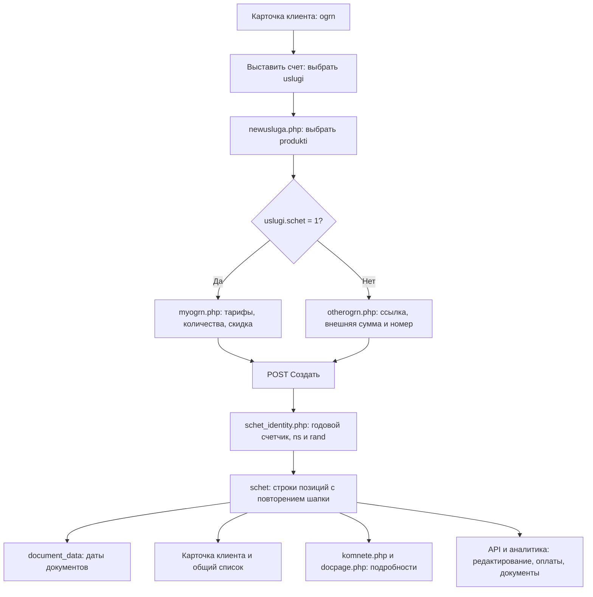

> Механизм нумерации изменён 27.10.2026: вывод только из `schet.ns`, предварительное резервирование и аудит описаны в [актуальной инструкции](INVOICE_NUMBERING.md). Описание прежнего аллокатора ниже — исторический снимок.

> Историческое исследование на дату в имени файла. Оно сохраняет исходные наблюдения и предложения; текущее состояние интеграции Контура описано в [инструкции](KONTUR_INTEGRATION.md).

# Выставление и отображение счетов Voovi: фактическое устройство

Исследование от 16 октября 2026 года. Описано текущее рабочее дерево PHP CRM, Django API и аналитики. Проверены исходники, форма в локальном браузере и структура/агрегаты локальной БД `voovi` контейнера `db`. Production и удалённые БД в этом исследовании не использовались. Создание, оплату, отправку и редактирование настоящего счёта не выполнял: соответствующие ветки прослежены по коду. Просмотр legacy-страниц сам по себе может вызывать описанные ниже служебные записи.

## 1. Основная модель

Счёт — группа строк таблицы `schet`. Отдельной таблицы шапок исходящих счетов нет. Каждая выбранная тарифная позиция обычно создаёт свою строку, а общие реквизиты и итоговая сумма повторяются во всех строках группы.



Связи на уровне приложения:

| Сущность | Связь |
|---|---|
| Клиент | `schet.idkli → ogrn.id` |
| Продукт | `schet.produkt → produkti.id` |
| Направление / принципал | `produkti.parent → uslugi.id` |
| Конкретная версия тарифа | `schet.prod → tarif.id` |
| Автор | `schet.kto → users.users_id` |
| Позиции одного счёта | общий `rand`, обычно также общий `ns` |
| Даты документов | `document_data.rand = schet.rand` |
| История работы | `schet_status.schet = schet.rand` |
| Комментарии | `schetoldkomment.schet = schet.rand` |
| Оплаты и возвраты | `kvobop.schet = schet.rand` |
| Агентские начисления | `av.rand = schet.rand` |
| Документы в наличии | `document_availability.rand = schet.rand` |
| Связанный товар / регкарта | `jurnalskzi.schet_id → schet.id`, то есть конкретная позиция |

Это логические связи: многие поля строковые, а целостность поддерживается PHP/Python, без внешних ключей.

Источники: [модель Schet](/Users/admin/Documents/Develop/Projects/SAVOIR/voovi/s.voovi.ru-api/basic/models.py:1397), [создание строк](/Users/admin/Documents/Develop/Projects/SAVOIR/voovi/voovi.ru/myogrn.php:1550).

## 2. Как пользователь доходит до создания

1. Открывает `kartklient.php?id=<ogrn.id>`.
2. Нажимает «Выставить счет».
3. Выбирает направление. Список строится через `users_access` текущего пользователя и `uslugi`, где `del='0' AND go='1'`.
4. Переходит в `newusluga.php`. Здесь выбирает продукт из `produkti`, где `parent=<uslugi.id> AND del='0'`, сортировка по имени.
5. Переходит в `newschet.php`. В URL передаются:

| GET-параметр | Значение |
|---|---|
| `id` | ID организации-клиента |
| `ogrn`, `inn`, `kpp` | реквизиты выбранной организации |
| `parent` | ID продукта; здесь это уже не ID направления |
| `tip` | ID направления `uslugi` |
| `head` | режим встраивания интерфейса |
| `rand` | присутствует при редактировании существующего счёта |
| `oldns` | может предварительно заполнить предыдущий счёт |

`newschet.php` проверяет авторизацию и читает `uslugi.schet`: значение `1` подключает `myogrn.php`, остальные значения — `otherogrn.php`. Это **настройка направления**, а не выбор по наличию/отсутствию контрагента в базе. Оба сценария используют уже выбранного клиента.

В локальной копии БД: `uslugi.id=1`, АО «ПФ „СКБ Контур“», имеет `schet=0`; ИЦ SAVOIR (12), бухгалтерия (21), маркировка (22), кассы (24), ЭДО (25), технические центры и разработка — `schet=1`.

Источники: [кнопка в карточке](/Users/admin/Documents/Develop/Projects/SAVOIR/voovi/voovi.ru/kartklient.php:226), [выбор продукта](/Users/admin/Documents/Develop/Projects/SAVOIR/voovi/voovi.ru/newusluga.php:412), [развилка](/Users/admin/Documents/Develop/Projects/SAVOIR/voovi/voovi.ru/newschet.php:23).

## 3. Основной сценарий: myogrn.php

### 3.1. Новый счёт и продление

В форме по умолчанию выбран режим «Продление». Пока предыдущий счёт пуст, блок тарифов и кнопка создания скрыты. В режиме «Новый» открывается весь блок.

Для продления можно ввести `nsold` или выбрать одну из подсказок: до 20 последних счетов того же клиента и продукта, `del='0'`, группировка по `ns`. Запрос к `oldschet.php` проверяет существование номера и соответствие клиенту/продукту.

Важная особенность: успешная **проверка** предыдущего счёта уже делает `INSERT INTO schetprodlen(schetold,dateprod)`. Это происходит до «Создать», при AJAX-проверках ввода, и может повторяться. Она не является только чтением и не доказывает, что продление затем создано.

Сам переключатель режима `idprodkschet` не имеет `name` и не сохраняется. Бизнес-признак продления — заполненный `schet.shetold`, полученный из `POST nsold`. `prodlen` — другое поле, с отдельным назначением в сопровождении; при создании оно равно `0`.

Источники: [форма и подсказки](/Users/admin/Documents/Develop/Projects/SAVOIR/voovi/voovi.ru/myogrn.php:2421), [переключение режима](/Users/admin/Documents/Develop/Projects/SAVOIR/voovi/voovi.ru/myogrn.php:2999), [проверка предыдущего счёта](/Users/admin/Documents/Develop/Projects/SAVOIR/voovi/voovi.ru/oldschet.php:5).

### 3.2. Поля, которые заполняет сотрудник

| Элемент | POST / поле БД | Поведение |
|---|---|---|
| Предыдущий счёт | `nsold → shetold` | для связи с продлением |
| Выбор тарифов | checkbox с именем `<tarif.id>` | в счёт попадают отмеченные тарифы |
| Количество | `input<tarif.id> → kvo` | целое число, HTML `min=0`, `step=1`; checkbox устанавливает количество 1 или 0 |
| Скидка, % | `skidka → skidka` | общая скидка, HTML 0–100, по умолчанию 0 |
| Итог SAVOIR | скрытый `aallsumm → price` | вычисляется в JavaScript, пользователь непосредственно не вводит |
| Ссылка | `url → url` | ссылка на внешний счёт, по умолчанию пусто |
| Сумма | `priceks → priceks` | сумма Контура / внешняя сумма или расход; это отдельная сумма от итога SAVOIR |
| Номер счёта | `nomerschetks → nomerschetks` | внешний номер, вводится вручную |
| Агент | `agent → agent` | выбор из `agent`, значение 0 означает «не выбран» |
| Телефон | `tel → tell` | показывается, если `produkti.tel == 1` |
| Количество строк описи | `kol_opis → kol_opis` | для специальных продуктов маркировки |
| Кто составил опись | `sos_opis → sos_opis` | пользователь-составитель |
| Тип ОП, доп. услуги, число ЭЦП | `av`, `dobusl[]`, `sht` | формируют записи `av`, а не обычные тарифные позиции |
| Дополнительные продукты ОП | `dobprod[]`, `avdob[]`, `dobuslpr[]`, `shtpr[]` | дополнительные данные агентских начислений |

Для продукта 319 блок ссылки, внешней суммы, номера и агента скрыт PHP-условием. Поля описи показываются для `[319,400,391,426,428,427,434,435]`; проверка непустого количества перед выдачей номера перечисляет только `[319,400,391,426,428,427]`. Следовательно, условия показа и проверки не полностью совпадают. Проверка выводит alert, но не завершает обработчик: `else` ограничивает выделение номера/агентский блок, а последующий блок INSERT расположен после него. Поэтому это не надёжная серверная остановка создания; при таком POST последующий код может работать с пустыми идентификаторами.

Часть старой формы сохранилась в обработчике, но скрыта/закомментирована: выбор договора `dog`, признак `checkl`, отдельный блок выезда. Наличие обработчика POST ещё не означает, что сотрудник сейчас видит такое поле.

### 3.3. Какие тарифы доступны

При новом счёте выбираются активные `tarif_parent` и связанные неудалённые версии `tarif`. В `schet.prod` записывается ID конкретной версии, а не `tarif_parent.id` и не `sync_id`.

При старом PHP-редактировании список — объединение действующих тарифов и уже выбранных в этом счёте версий. Поэтому старая версия остаётся доступной для сохранения даже после изменения каталога.

Источник: [voovi_tarif_schet_query](/Users/admin/Documents/Develop/Projects/SAVOIR/voovi/voovi.ru/tarif_identity.php:333).

### 3.4. Как считается сумма

На форме:

```text
позиция_i = tarif.price_i × количество_i
до_скидки = сумма(позиция_i) + выезд
price = до_скидки × (100 − skidka) / 100
```

Тарифная цена выводится из `tarif.price`; в PHP удаляются обычные и тонкие пробелы. Промежуточные значения используют JavaScript Number/parseFloat, итоговая скидка — Decimal.js. Пересчёт общего итога запускается каждые 500 мс. В старом скрытом блоке выезда есть фиксированные суммы, расчёт километров и специальный код `162534` («Связанная»); он не является обычной видимой частью текущей формы.

PHP принимает `POST aallsumm` и записывает его в **каждую выбранную строку**. При первоначальном создании сервер не пересчитывает этот итог единым денежным калькулятором. Это не цена конкретной позиции, несмотря на имя `price`.

Например, две позиции по 2200 рублей и скидка 10% дают итог 3960 рублей. В двух строках `schet.price` будет по `3960`, а не по `1980`. `SUM(schet.price)` по строкам даст ошибочные 7920 рублей. Для итогов по счетам нужно сначала выделить группы и проверить согласованность шапки.

`priceks` не прибавляется к `price`: система ведёт их отдельно. Поле `summa` также существует, но основной INSERT формы не записывает в него рассчитанный итог.

Источник: [расчёт alsum](/Users/admin/Documents/Develop/Projects/SAVOIR/voovi/voovi.ru/myogrn.php:2727).

## 4. Номера и идентификаторы

| Поле / представление | Что означает |
|---|---|
| `id` | AUTO_INCREMENT отдельной позиции |
| `kolichschet` | следующий номер общего годового счётчика |
| `ns` | бизнес-номер Voovi: конкатенация года, автора, отдела и годового номера |
| `rand` | ключ группы позиций и большинства связанных сущностей |
| `nomerschetks` | внешний номер, введённый сотрудником |
| `nomerschet` | legacy-порядковый номер по клиенту либо маркер `В КС`; основной современный `ns` строится без него |
| `nomerdog` | отдельный порядковый номер договора |
| `S_`, `K_` | подписи интерфейса перед номером; не отдельные идентификаторы БД |
| порядковый № строки списка | счётчик отображения `$iz++`, не номер документа |

### 4.1. Выдача номера

`voovi_allocate_schet_identity($god,$kto,$otdel)`:

1. Нормализует ключ счётчика: `2026` и `26` используют `schetnum.god='26'`.
2. Выполняет `LOCK TABLES schetnum WRITE, schet READ`.
3. Находит максимальный числовой `kolichschet` в `schet` за соответствующий год среди `del='0'`, учитывая оба написания года.
4. Читает `schetnum`. Если строки года нет — создаёт её с нулём.
5. Поднимает счётчик до найденного максимума, если сохранённый счётчик отстал.
6. Увеличивает `num` на 1 и сохраняет.
7. Строит `rand`: номер с минимум пятью цифрами + текущая дата `Ymd`. При совпадении существующего `rand` добавляет двухзначный суффикс попытки.
8. Освобождает блокировки и возвращает значения.

```text
ns = god + users_id + users.otdel + kolichschet
rand = sprintf('%05d', kolichschet) + date('Ymd') [+ суффикс]
```

Условный пример: год `26`, автор `42`, отдел `3`, порядковый номер `157` → `ns=26423157`, `rand=0015720261016` на дату 16.10.2026. Разделителей и фиксированной ширины частей `ns` нет. Филиал, клиент, продукт и выбранный принципал в эту формулу не входят. `users.otdel` и `uslugi.id` — разные сущности.

Счётчик общий для года, не отдельный для каждого сотрудника/клиента/направления. Номер выделяется при POST «Создать», а не при открытии формы. Он резервируется **до** записи строк, и общая транзакция отсутствует: ошибка после выделения может оставить пропуск в нумерации.

Обычное создание передаёт `date('y')`, ветка `otkazschet.php` — `date('Y')`: ключ счётчика нормализуется, но возвращаемый `ns` использует год в переданном виде. В истории могут встречаться номера с годом из двух и четырёх цифр.

Источник: [аллокатор целиком](/Users/admin/Documents/Develop/Projects/SAVOIR/voovi/voovi.ru/schet_identity.php:84).

### 4.2. Проверка внешнего номера

`schet-number-check.js` вызывает `schet_number_check.php`. Проверяется `TRIM(nomerschetks)` по всей таблице, без ограничения клиента/года/направления; текущий `rand` при редактировании исключается. Запрос учитывает `cher='0' AND otk='0'`; отгруженные и `del='1'` версии не исключаются.

В терминологии фактического кода `cher` — отказ, `otk` — черновик. Комментарий над SQL в проверке номера не следует использовать как источник назначения этих полей.

Найденный дубль — **предупреждение с разрешением продолжить**. Пока проверка выполняется или завершилась ошибкой, отправка формы блокируется; после ответа с `exists=true` — разрешена. Пустой внешний номер не блокирует отправку. В обработчике создания нет эквивалентной жёсткой проверки уникальности; это не гарантия от конкурентных дублей.

Источники: [запрос проверки](/Users/admin/Documents/Develop/Projects/SAVOIR/voovi/voovi.ru/schet_number_check.php:33), [поведение формы](/Users/admin/Documents/Develop/Projects/SAVOIR/voovi/voovi.ru/js/schet-number-check.js:77).

### 4.3. Договор и legacy-номер

В обычной ветке `$zs` берётся как `nomerschet + 1` последней записи клиента по `id DESC`, без фильтра активных версий. Это отдельная последовательность, не годовой `schetnum`.

`$ze` — максимальный `dogovor.nomer + 1`. Запись в `dogovor` создаётся при `$_POST['dog'] == 0`, поля договора: год, филиал, отдел, номер, ID клиента. Выбор `dog` в текущей форме закомментирован. В используемом PHP 5.6 отсутствующее значение `NULL == 0` даёт `true`; это проверено отдельно без подключения к БД. Поэтому отсутствие видимого выбора не означает отсутствия создания договора. Его номер берётся через MAX+1 без блокировки.

Старые представления используют разные составные номера: в `setschet.php`/старом заголовке `schet.php` встречается `god+filial+otdel+client.id+nomerschet`, современные список/документы используют `god+kto+otdel+kolichschet` / сохранённый `ns`. Это разные алгоритмы.

## 5. Что записывается при «Создать»

### 5.1. Обычная тарифная ветка

Перед позициями могут создаваться записи агентских начислений `av`, журнал `aktivn` («Новый счет») и договор. `sortir` устанавливается как текущий максимум `schet.sortir + 1`, без отдельной блокировки.

На каждый выбранный тариф выполняется INSERT со следующими источниками:

| Поля `schet` | Откуда берутся |
|---|---|
| `ns`, `rand`, `kolichschet` | аллокатор номера; присланный скрытый `shetrand` заменяется серверным |
| `shetold` | `POST nsold` |
| `gen` | свойство выбранного тарифа |
| `idkli` | GET `id` |
| `sortir` | MAX(sortir)+1 |
| `otdel`, `filial`, `kto` | текущий `users` |
| `god` | текущий год из двух цифр |
| `nomerdog`, `nomerschet` | отдельные legacy-счётчики, описанные выше |
| `nomerschetks`, `priceks`, `url`, `tell`, `agent` | ввод сотрудника |
| `prod`, `kvo` | ID версии тарифа и количество |
| `produkt` | выбранный GET `parent` |
| `kvogorod`, `goroddd` | старые поля расчёта выезда |
| `prodlen` | строка `0` |
| `skidka`, `price` | процент скидки и итог `aallsumm` |
| `ogrn` | GET `ogrn` |
| `name`, `inn`, `kpp` | реквизиты из `ogrn` по ID клиента |
| `data` | текст `d.m.y в H:i` |
| `d`, `m`, `y` | текущая дата, год здесь из четырёх цифр |
| `time` | передаётся строка `H:i`, хотя колонка имеет тип int |
| `oferta` | `POST dog`, даже когда поля нет в форме |
| `Lagent` | результат проверки `checkl`, обычно 0 |
| `sos_opis`, `kol_opis` | поля описи из POST |
| `nds` | значение `uslugi.nds`; пустое, `none` или NULL преобразуется в SQL NULL |

После позиций создаётся `document_data` с общим `rand` и текущей датой в `d_bill`, `d_contract`, `d_specification`, `d_act`, `d_tn`. Формат PHP — `y-m-d`, MySQL интерпретирует двухзначный год. `type_contract` использует default `oferta`. Новые поля `d_invoice_advance` и `d_upd` этим INSERT не заполняются.

Затем JavaScript перенаправляет в карточку клиента. Создание счёта не означает, что PDF уже сформирован, счёт отправлен клиенту, получена оплата или выполнена отгрузка.

Начальные признаки берутся из defaults БД: `del=0`, `oplachen=0`, `oplachenks=0`, `gotov=0`, `akt=0`, `otk=0`, `cher=0`, `doljen=0`, `doljenop=0`, `prodlens=0`, `prodlenks=0`. `status` первоначально пустой; начальная запись `schet_status` в INSERT-процессе не создаётся. Контакт, исполнитель, подписант, владелец сертификата и даты поставки не выбираются в основной форме — дополняются позднее.

`date_create` выставляется БД через `CURRENT_TIMESTAMP`, а не PHP-формой. Оно относится к созданию конкретной строки: после замены позиций уже не обязательно совпадает с первоначальной датой бизнес-счёта.

Источники: [основной INSERT](/Users/admin/Documents/Develop/Projects/SAVOIR/voovi/voovi.ru/myogrn.php:1550), [даты документов](/Users/admin/Documents/Develop/Projects/SAVOIR/voovi/voovi.ru/myogrn.php:1639), [НДС направления](/Users/admin/Documents/Develop/Projects/SAVOIR/voovi/voovi.ru/myogrn.php:799).

### 5.2. Продление и специальные ветки

При `nsold` заполненном и ненулевых суммах обновляются `prodlens`/`prodlenks` **старого** счёта. Условия назначения этих двух флагов отличаются между веткой `dog==2`, обычной веткой и старым сохранением; это нельзя свести к одному универсальному правилу без учёта обработчика.

Ветка `dog==2` записывает `nomerdog='В КС'`, `nomerschet='В КС'` и единственную строку вместо обычного цикла тарифов. В текущей видимой форме выбора `dog==2` нет. В ней есть обращения к `$rowazaza` вне тарифного цикла: её нельзя считать полноценным альтернативным современным тарифным процессом.

Для направления 12 и заполненного внешнего номера создаются записи `av`: основной продукт, доп. услуги/продукты, роли `pagent/sagent/dagent`, количество ЭЦП, `rand`, внешний номер, внешняя сумма и автор. Типы ОП в форме: 0 — новый; 1 — продление; 2 — удостоверение личности от Контура; 3 — ускоренное; 4 — бесплатно. Это отдельная ось от режима «Новый/Продление» наверху формы. Дополнительный продукт агентского блока не равнозначен строке обычного тарифа.

Сохранилась также ветка выезда после тарифного цикла: при невыбранном первом тарифе и непустом/ненулевом `goroddd` она пытается вставить ещё одну строку, используя `$rowazaza` после цикла. Это legacy-обработчик скрытого блока, а не обычная позиция текущей формы.

В конце обычной ветки сохранился дополнительный INSERT в `schet` только с `dobprod/kto` с лишней запятой в VALUES. Если исполнение дойдёт до него при непустом массиве, этот SQL некорректен. Основные позиции и связанные записи к этому моменту уже могли быть записаны; браузерный redirect уже выведен. В рамках исследования эта ветка не запускалась.

Источник: [конец создания и начало сохранения](/Users/admin/Documents/Develop/Projects/SAVOIR/voovi/voovi.ru/myogrn.php:1820).

## 6. Упрощённый внешний сценарий: otherogrn.php

Видимые поля: **ссылка, сумма, номер счёта**. Никакого выбора тарифов, количества, скидки и режима продления в этой форме нет.

При POST:

1. Контрагент ищется по GET `inn/kpp`.
2. Выделяются обычные Voovi `ns/rand/kolichschet`.
3. Создаётся одна строка `schet`: `nomerdog='В КС'`, `nomerschet='В КС'`, `nomerschetks=POST`, **`priceks=POST aallsumm`**. `price` не передаётся и остаётся default 0.
4. Сохраняются клиент, продукт, автор, отдел, филиал, дата, ссылка.
5. Создаётся `document_data` с пятью датами, затем переход в карточку клиента.

Код также пытается читать `prod/kvo` из `$rowazaza`, хотя тарифного цикла здесь нет; ряд POST-полей, например `agent/dog/skidka`, отсутствует в видимой форме. НДС направления в этот INSERT не передаётся. Не следует считать такую строку обычным полноценным тарифным счётом SAVOIR для печати новым калькулятором.

В списке внутренний номер скрывается условием `nomerschet == 'В КС'`; показывается внешний номер. При этом внутренний `ns` и служебный `rand` всё равно существуют в базе.

Источник: [сохранение и форма](/Users/admin/Documents/Develop/Projects/SAVOIR/voovi/voovi.ru/otherogrn.php:392).

## 7. Как счёт появляется в системе

### 7.1. Карточка клиента

`kartklient.php → tabl.php → inctoha.php`.

Активная таблица выбирает `del=0, akt=0, cher=0, otk=0, idkli=<клиент>`, группирует по `rand`, сортирует по `id DESC`. Потом применяются текущая организация пользователя, `users_access` и проверка отдела через `dotdel` в рендерере. Поэтому отсутствие только что созданного счёта в таблице может быть связано с фильтром направления/доступа.

В колонках показываются:

- внутренний номер из `god+kto+otdel+kolichschet` и внешний `nomerschetks` (кроме маркера `В КС`);
- дата из `document_data.d_bill`;
- ИНН, КПП, сохранённое название клиента, продукт;
- комментарий и последний рабочий статус;
- избранное и информация об оплате;
- «Контур» = `priceks`, «S» = `price`;
- тип сопровождения, автор, агент и исполнитель.

Для внешнего номера в карточке при наличии `url` строится ссылка на этот URL. Название клиента ведёт в `/payments/SearchBill?n_schet=<ns>`; название продукта — в `/payments/EditTarifSchet?n_schet=<ns>`. Подробнее счёт открывается через `komnete.php` во встроенной панели/окне.

Архивные, отказные и черновые счета загружаются отдельно через `table_otgr_ajax.php`, по 5 групп: берётся максимальный ID каждой группы `rand`, затем проверяется доступ. Это не тот же запрос, что для активной таблицы.

Источники: [активный список](/Users/admin/Documents/Develop/Projects/SAVOIR/voovi/voovi.ru/tabl.php:91), [рендер строки](/Users/admin/Documents/Develop/Projects/SAVOIR/voovi/voovi.ru/inctoha.php:44), [архивная подгрузка](/Users/admin/Documents/Develop/Projects/SAVOIR/voovi/voovi.ru/table_otgr_ajax.php:49).

### 7.2. Общая таблица и процесс

`toha.php` применяет фильтры текущего направления/доступа, автора, дат, рабочего статуса, оплаты, отгрузки, черновика, отказа, долга и других признаков; использует тот же `inctoha.php`. Там SELECT DISTINCT по общим полям, а не выделенная сущность шапки; расхождения общих полей между позициями могут дать несколько строк одного счёта. Текущая сортировка — по последней записи `schet_status` и затем `schet.id`, по возрастанию.

`check.php` содержит разделы «Я в компании», «Таблица счетов», «Процесс в счетах». Процесс загружает `procinschet.php`, периоды и `tablschetosn.php`. Там разные выборки под категории, часто `GROUP BY ns`, разделение новых/продлений по пустому/заполненному `shetold`, фильтрация по `CONCAT(y,'-',m,'-',d)`. Встречаются условия исключения продлённых счетов по `prodlens/prodlenks`.

Даты и группировки в этих представлениях отличаются от карточки клиента. Изменение даты документа через новый API меняет `document_data`; старый редактор даты в `docpage.php` обновляет одновременно `d/m/y` и даты документов. Поэтому поведение зависит от использованного редактора.

Источники: [общая таблица](/Users/admin/Documents/Develop/Projects/SAVOIR/voovi/voovi.ru/toha.php:801), [пример выборки процесса](/Users/admin/Documents/Develop/Projects/SAVOIR/voovi/voovi.ru/tablschetosn.php:3739).

### 7.3. Цвет и оплата

Строка получает классы по `akt`, `otk`, `cher`, оплате и отложенному действию; эти условия независимы и могут конфликтовать. Ускоренный тариф выделяется красной рамкой.

В колонке «Контур» зелёное состояние задаётся `oplachenks=1` или нулевой `priceks`. В колонке «S» используется сумма `kvobop.summa` по `rand` и сравнение с `price`. В legacy-условиях зелёный цвет возможен при `0 < оплачено <= price`, то есть и при частичной оплате. Цвет не является надёжной универсальной проверкой полной оплаты.

Подгрузка карточки суммирует `kvobop.summa` без классификации направления операции. Более новый `kvobop_net_total` в аналитике учитывает поступления и возвраты через `kvobop_tip`. Это разные способы расчёта отображаемой оплаты.

Источники: [цвета денежных колонок](/Users/admin/Documents/Develop/Projects/SAVOIR/voovi/voovi.ru/inctoha.php:631), [предзагрузка оплат](/Users/admin/Documents/Develop/Projects/SAVOIR/voovi/voovi.ru/kart_schet_preload.php:124), [сумма с возвратами](/Users/admin/Documents/Develop/Projects/SAVOIR/voovi/analitic/utils/func.py:74).

## 8. Карточка счёта, последующее заполнение и статусы

`komnete.php` загружает активные позиции по `rand`, данные клиента, продукта, принципала, контактов, комментариев и статусов. Через `docpage.php` показывает счёт, суммы, даты и документы. Кнопка «Состав» раскрывает тарифы, количество, базовую цену, скидку, сумму каждой позиции и итог.

Состав пересчитывается по `tarif.price × kvo × (1−skidka/100)`, с округлением суммы строки до копеек. Если тариф/количество не позволяют посчитать, применяется fallback на сохранённый `schet.price`. Для нескольких неполных строк такой fallback может повторно учесть общую сумму.

Позже заполняются контакт `lico`, исполнитель `generac`, подписант, владелец сертификата, адрес, комментарии, рабочий статус, тип и даты продления, данные описи и наличие документов. Многие элементы сохраняют изменения отдельными AJAX-запросами к `pusya.php`, а не общей кнопкой формы.

| Признак | Реальная роль |
|---|---|
| `status` | рабочий статус из справочника `status` по направлению |
| `schet_status` | история рабочего статуса с автором и датой |
| `oplachen` | отдельный legacy-признак оплаты SAVOIR |
| `oplachenks` | оплата внешней части / используемый рядом сценариев общий флаг |
| `gotov` | готовность |
| `akt`, `akt_date` | отгрузка / архив и учётный месяц |
| `otk` | черновик |
| `cher` | отказ |
| `del` | скрытая старая версия/удалённая позиция |
| `doljen`, `doljenop` | дополнительные признаки задолженности |
| `shetold` | номер предыдущего счёта |
| `tipprod` | что продлевать: сертификат, поставку, оба или «Нет» |
| `dataprod`, `datasert` | даты окончания сертификата и поставки соответственно |
| `prodlens`, `prodlenks` | отметки, что соответствующая часть прежнего счёта продлена |

При смене рабочего статуса `getstatusschet.php` добавляет историю, обновляет `status/sortir` по `rand` и **безусловно снимает отгрузку**: `akt=0, akt_date=''`. Это существенный побочный эффект смены рабочего статуса.

Отгрузка через `invoice_action.php` проверяет оплату/сумму для определённых направлений, выбранный тип продления и обязательные даты. Устанавливает `akt=1`, `akt_date=date('ym')`, меняет сортировку и может создавать `call_center` для будущего продления. API `schet-shipment/<ns>` ставит отгрузку напрямую и не воспроизводит эти PHP-проверки.

Отказ через API меняет `cher`, причину, автора и дату по тому же `ns`. Старый `otkazschet.php` для уже отгруженного счёта может создать отдельную группу с новым `ns/rand`, `shetold=<старый ns>`, `cher=1`. Для неотгруженного меняет существующую группу. Эти сценарии нельзя считать одинаковыми.

Источники: [состав](/Users/admin/Documents/Develop/Projects/SAVOIR/voovi/voovi.ru/komnete.php:123), [вывод состава](/Users/admin/Documents/Develop/Projects/SAVOIR/voovi/voovi.ru/docpage.php:361), [смена статуса](/Users/admin/Documents/Develop/Projects/SAVOIR/voovi/voovi.ru/getstatusschet.php:14), [отгрузка](/Users/admin/Documents/Develop/Projects/SAVOIR/voovi/voovi.ru/invoice_action.php:3), [старый отказ](/Users/admin/Documents/Develop/Projects/SAVOIR/voovi/voovi.ru/otkazschet.php:17).

## 9. Два механизма редактирования

### 9.1. Старое PHP-сохранение

`newschet.php?...&rand=<существующий>` ведёт в `myogrn.php`, кнопка `submitsave`.

- Берёт прежние `rand/kolichschet/ns`. Если `ns` пуст или 0 — собирает его из частей.
- Пишет «Счет изменен» в `aktivn`.
- Старые позиции помечает `del=1` либо удаляет промежуточные активные позиции в зависимости от выбранной исходной строки.
- Удаляет старые записи `av` и пересоздаёт их для нужного сценария.
- Вставляет новые позиции с прежним номером и ключом, выбранными тарифами и новым итогом.
- Не копирует весь набор 111 полей. Например, часть флагов/контактов может вернуться к defaults.
- В INSERT есть подозрительное присваивание `oferta ← прежний time`, не выбранный договор.
- Строка SQL для `document_data` сформирована, но в конце этой ветки не выполнена `mysql_query`.

Это замена набора строк, а не аккуратный UPDATE каждой позиции. ID позиций меняются, что важно для регкарт/склада. При этом `kto/otdel/filial` берутся у текущего редактора, а сохранённый `ns` остаётся прежним. Если редактор отличается от автора, номер, заново собранный старым интерфейсом из частей, может отличаться от `ns`, используемого API и документами.

Источник: [submitsave](/Users/admin/Documents/Develop/Projects/SAVOIR/voovi/voovi.ru/myogrn.php:1849).

### 9.2. Аналитика и Django API

`/payments/SearchBill` и `/payments/EditTarifSchet` в интерфейсе аналитики требуют право `J`.

Номер Контура, внешняя сумма и ссылка редактируются через `/payments/EditSchet`, который вызывает API. Замена тарифов отправляет `PUT /api/v1/schet/<ns>` со скидкой и массивом `{id,kvo}`.

`SchetEditSerializer`:

1. Находит все активные позиции `ns`.
2. Запрещает редактирование при наличии связанных товаров `jurnalskzi.schet_id`.
3. Без массива тарифов меняет переданные реквизиты на существующих строках.
4. С тарифами проверяет единый продукт, считает общий итог, помечает старые строки `del=1`, копирует данные прежней строки в новые позиции.
5. Сохраняет `ns/rand`, меняет `prod/kvo/produkt/skidka/price`; новый годовой номер не выделяет.
6. Синхронизирует внешний номер/сумму и роли агентских записей `av`; разные участки обработчика обновляют разное число записей `av`.

Расчёт здесь также отличается: базовые цены сначала преобразуются в float, потом итог — в Decimal с округлением до двух знаков. Сохранение новых тарифов не переносит явно все остальные переданные поля этого же запроса.

На экране дополнительно проверяется наличие счёта в Эврике / Контур Бухгалтерии: если найден, интерфейс просит сначала удалить его там и скрывает редактирование. Эта проверка вызывает интеграцию; при исследовании её не запускал. Она находится в UI-потоке и не заменяет серверную проверку связанных товаров.

`PATCH /api/v1/schet/<ns>` использует другой сериализатор с `fields='__all__'`, все поля необязательны, массово присваивает переданные значения активным позициям. Правила PUT и PATCH не одинаковые.

Источники: [экраны аналитики](/Users/admin/Documents/Develop/Projects/SAVOIR/voovi/analitic/payments/views.py:844), [обработчик API](/Users/admin/Documents/Develop/Projects/SAVOIR/voovi/s.voovi.ru-api/basic/views.py:579), [сериализатор](/Users/admin/Documents/Develop/Projects/SAVOIR/voovi/s.voovi.ru-api/basic/serializers.py:47), [проверка Эврики](/Users/admin/Documents/Develop/Projects/SAVOIR/voovi/analitic/templates/payments/EditTarifSchet/index.html:484).

## 10. Как формируется документ счёта

Основной современный путь из `docpage.php`: `/different/dwdocs/<ns>?type=bill_pdf` либо `bill_pdf_signature` → аналитика → API `GET /api/v1/schet/<ns>/pdf` → `DocPdf`. Есть DOCX, договор, спецификация, акт, УПД, накладная, счёт-фактура на аванс, XML и ZIP. Отправка через Диадок — отдельное действие.

Экран `/different/diadoc?ns=<ns>` требует заполненных типа и региона организации; иначе показывает форму дозаполнения. Тип договора и даты управляются через `document_data`.

`DocPdf.bill_info` берёт:

| Данные документа | Источник |
|---|---|
| Номер | сохранённый `schet.ns` |
| Дата счёта | `document_data.d_bill` |
| Продавец и банк | текущая `uslugi`, определённая по продукту |
| Покупатель и реквизиты | текущая `ogrn` по `idkli`, а не только сохранённая копия названия в `schet` |
| Наименование, единица, базовая цена позиции | конкретная запись `tarif` по `prod` |
| Количество и скидка | `schet.kvo/skidka` |
| НДС | сохранённый `schet.nds`, не автоматически текущая ставка принципала |
| Подписант | `schet.podpisant → klient` |

Расчёт документа:

```text
цена_со_скидкой = ROUND_HALF_UP(тариф × (100−скидка)/100, 2)
сумма_строки = ROUND_HALF_UP(цена_со_скидкой × количество, 2)
итог = сумма(сумма_строки)
НДС_внутри = ROUND_HALF_UP(сумма_строки × ставка/(100+ставка), 2)
```

Расхождение суммы НДС по строкам с НДС от общего итога корректируется в последней облагаемой позиции. QR-код содержит реквизиты получателя, номер, дату и сумму в копейках.

**PDF пересчитывает итог из тарифов и количеств, а не просто печатает `schet.price`.** Форма округляет иначе; карточка состава округляет после умножения количества, PDF сначала округляет цену за единицу. Возможны копеечные расхождения. Старый скрытый выезд, записанный только в `goroddd/kvogorod`, этот цикл PDF отдельно не добавляет.

В проекте остаётся старый `schet.php`: собственный HTML/Word `.doc`, создаёт каталоги/файл при открытии и имеет иной legacy-заголовок номера. Его нельзя принимать за единственный действующий механизм печати.

Источники: [ссылки печати](/Users/admin/Documents/Develop/Projects/SAVOIR/voovi/voovi.ru/docpage.php:294), [получение PDF](/Users/admin/Documents/Develop/Projects/SAVOIR/voovi/s.voovi.ru-api/basic/views.py:651), [данные и расчёт](/Users/admin/Documents/Develop/Projects/SAVOIR/voovi/s.voovi.ru-api/utils/create_pdf/doc_pdf.py:169), [округление](/Users/admin/Documents/Develop/Projects/SAVOIR/voovi/s.voovi.ru-api/utils/create_pdf/billing_calc.py:19).

## 11. Оплата после выставления

Счёт и платёж — разные записи. Банковская платёжка лежит в `payment`, наличная — в `payment_nal`; распределения и возвраты — в `kvobop`. Связь со счётом идёт по `rand`, с платёжкой — по `random_key`.

При распределении в аналитике `regpay` проверяет сумму и остаток, отсутствие повторной привязки, создаёт `kvobop`. При полной оплате может поставить автоотгрузку по настройкам продукта/принципала и признак оплаты; для некоторых сценариев создаётся чек. Частичная оплата учитывается отдельными операциями. Итог счёта в этой логике берётся из `price`, не как сумма повторённых `price` позиций.

Флаг оплаты в PHP может меняться вручную отдельно от `kvobop`. Поэтому следует различать «поставили флаг оплаты», «распределили деньги», «пробили чек» и «отгрузили»: это четыре разных события.

Источник: [распределение платежа](/Users/admin/Documents/Develop/Projects/SAVOIR/voovi/analitic/utils/func.py:95).

## 12. Подтверждённые ограничения и неоднозначности

1. Нет выделенной шапки; общие поля повторяются. Запросы `GROUP BY rand`, `GROUP BY ns`, `DISTINCT` и `.first()` могут выбирать разные представления при рассогласовании данных.
2. В `schet` 111 колонок. Уникальный индекс только на `id`; индексы `ns/rand` не обеспечивают уникальность бизнес-групп. Уникальность строкового `ns` нельзя подтвердить по наличию аллокатора.
3. Таблица `schet` — MyISAM, `schetnum` и `document_data` — InnoDB. Резервирование номера и вставки не образуют атомарного действия, а Django `transaction.atomic` не откатывает MyISAM.
4. До/после создания есть побочные записи: проверка продления пишет `schetprodlen`; загрузка списка может восстановить `ns=0`, записать `install` или создать отсутствующий `document_data` через `getDateDocuments`.
5. Первоначальная сумма доверяется POST. PDF, SQL API, карточка состава и экран создания используют разные способы расчёта и округления.
6. Внешний номер необязателен и может повторяться. Проверка дубликата не ограничена годом/направлением и не является серверным ограничением.
7. Две даты: дата документа и дата создания из `d/m/y`. Дополнительно есть строковый `date_schet`, текстовый `data`, timestamp `date_create`, даты оплаты/отгрузки.
8. `time` имеет тип int, но PHP передаёт `H:i`; в локальном режиме MySQL без strict mode такое значение не сохраняет минуты как время.
9. Старое PHP-редактирование копирует только часть полей; есть подозрительные присваивания/неисполненный SQL дат. Новый API копирует шире, но тоже не имеет единой транзакции замены.
10. Рабочий статус и финансовые флаги независимы, но смена статуса через PHP снимает отгрузку. Правила API-отгрузки и PHP-отгрузки различаются.
11. Внешний сценарий не формирует полноценный тарифный состав. Новая печать ожидает существующие тарифы и даты документов, поэтому совместимость неполных старых строк нельзя предполагать.

Контрольные агрегаты локальной копии на момент исследования, без вывода контрагентов и сумм отдельных счетов:

| Проверка | Результат |
|---|---:|
| Активные строки `schet` (`del=0`) | 139 501 |
| Различные активные `rand` | 97 417 |
| Различные активные `ns`, включая пустые/0 | 92 109 |
| Группы `rand` с несколькими активными позициями | 23 530 |
| Группы с пустым/нулевым `ns` | 5 050 |
| Ненулевые номера `ns`, общие для нескольких `rand` | 123 |
| Группы `rand` с разными значениями `price` в активных строках | 375 |
| Активные группы без `document_data` | 35 926 |
| Значения `document_data.rand` с несколькими записями | 20 |

Это характеристика локального исторического набора, а не доказательство, что все расхождения появились из-за текущей формы. Отчёт не предполагает автоматического исправления этих данных.

## 13. Карта основных точек кода

| Часть | Файл |
|---|---|
| Вход в выставление | [kartklient.php](/Users/admin/Documents/Develop/Projects/SAVOIR/voovi/voovi.ru/kartklient.php:226) |
| Каталог продукта | [newusluga.php](/Users/admin/Documents/Develop/Projects/SAVOIR/voovi/voovi.ru/newusluga.php:96) |
| Развилка формы | [newschet.php](/Users/admin/Documents/Develop/Projects/SAVOIR/voovi/voovi.ru/newschet.php:23) |
| Тарифное создание | [myogrn.php](/Users/admin/Documents/Develop/Projects/SAVOIR/voovi/voovi.ru/myogrn.php:830) |
| Внешнее создание | [otherogrn.php](/Users/admin/Documents/Develop/Projects/SAVOIR/voovi/voovi.ru/otherogrn.php:392) |
| Годовой номер | [schet_identity.php](/Users/admin/Documents/Develop/Projects/SAVOIR/voovi/voovi.ru/schet_identity.php:84) |
| Версии тарифов | [tarif_identity.php](/Users/admin/Documents/Develop/Projects/SAVOIR/voovi/voovi.ru/tarif_identity.php:333) |
| Активные счета клиента | [tabl.php](/Users/admin/Documents/Develop/Projects/SAVOIR/voovi/voovi.ru/tabl.php:91) |
| Общая строка списка | [inctoha.php](/Users/admin/Documents/Develop/Projects/SAVOIR/voovi/voovi.ru/inctoha.php:1) |
| Подробная карточка | [komnete.php](/Users/admin/Documents/Develop/Projects/SAVOIR/voovi/voovi.ru/komnete.php:24) |
| Документы и состав | [docpage.php](/Users/admin/Documents/Develop/Projects/SAVOIR/voovi/voovi.ru/docpage.php:196) |
| Общий список | [toha.php](/Users/admin/Documents/Develop/Projects/SAVOIR/voovi/voovi.ru/toha.php:801) |
| Процесс по периодам | [tablschetosn.php](/Users/admin/Documents/Develop/Projects/SAVOIR/voovi/voovi.ru/tablschetosn.php:1) |
| API чтения шапки/позиций | [SqlQuerySELECTgeneral.py](/Users/admin/Documents/Develop/Projects/SAVOIR/voovi/s.voovi.ru-api/utils/SqlQuerySELECTgeneral.py:4) |
| API изменения | [views.py](/Users/admin/Documents/Develop/Projects/SAVOIR/voovi/s.voovi.ru-api/basic/views.py:579) |
| Сохранение новых тарифов | [serializers.py](/Users/admin/Documents/Develop/Projects/SAVOIR/voovi/s.voovi.ru-api/basic/serializers.py:47) |
| Даты документов | [DocumentDataAPIview](/Users/admin/Documents/Develop/Projects/SAVOIR/voovi/s.voovi.ru-api/basic/views.py:1870) |
| PDF/DOCX | [DocPdf](/Users/admin/Documents/Develop/Projects/SAVOIR/voovi/s.voovi.ru-api/utils/create_pdf/doc_pdf.py:169) |

## 14. Полный состав таблицы schet

Ниже приведены все колонки действующей локальной таблицы. «Основное создание» означает обычный тарифный INSERT `myogrn.php`, без специальных/legacy-веток. Поля, отсутствующие в INSERT, получают default БД либо неявное значение при разрешающем SQL mode; это не означает, что они заполняются содержательно. Для nullable-полей SQL NULL указан явно; «—» означает отсутствие явного default в выводе SHOW COLUMNS. Назначение малопонятных legacy-полей не расширено предположениями.

| Колонка | Тип в локальной БД | Допускает NULL | Default | Основное создание |
|---|---|---|---|---|
| `id` | `int(10) unsigned` | Нет | — | AUTO_INCREMENT БД |
| `scheton` | `varchar(1)` | Нет | `0` | Не передаётся |
| `otl3` | `int(1)` | Нет | `0` | Не передаётся |
| `sortir` | `int(11)` | Нет | `0` | MAX(sortir)+1 |
| `ns` | `varchar(100)` | Нет | `0` | Аллокатор: god+kto+otdel+kolichschet |
| `shetold` | `varchar(10)` | Нет | — | POST nsold |
| `status` | `varchar(254)` | Нет | '' | Не передаётся |
| `install` | `varchar(33)` | Нет | `0` | Не передаётся |
| `start_acp` | `varchar(36)` | Нет | — | Не передаётся |
| `end_acp` | `varchar(36)` | Нет | — | Не передаётся |
| `del` | `varchar(2)` | Нет | `0` | Не передаётся |
| `idkli` | `varchar(11)` | Нет | — | GET id |
| `kolichschet` | `varchar(1366)` | Нет | `0` | Годовой счётчик schetnum |
| `uskoren` | `varchar(366)` | Нет | — | Не передаётся |
| `oplachen` | `varchar(10)` | Нет | `0` | Не передаётся |
| `oplachenks` | `varchar(10)` | Нет | `0` | Не передаётся |
| `date_op` | `date` | Нет | — | Не передаётся |
| `doljen` | `varchar(10)` | Нет | `0` | Не передаётся |
| `doljenop` | `varchar(10)` | Нет | `0` | Не передаётся |
| `gotov` | `varchar(10)` | Нет | `0` | Не передаётся |
| `doki` | `varchar(10)` | Нет | `0` | Не передаётся |
| `akt` | `varchar(10)` | Нет | `0` | Не передаётся |
| `otk` | `varchar(10)` | Нет | `0` | Не передаётся |
| `cher` | `int(11)` | Нет | `0` | Не передаётся |
| `postprod` | `varchar(20)` | Нет | `0` | Не передаётся |
| `akt_date` | `varchar(366)` | Нет | — | Не передаётся |
| `gen_date` | `varchar(366)` | Нет | — | Не передаётся |
| `date_schet` | `varchar(100)` | Нет | `0` | Не передаётся |
| `otdel` | `varchar(10)` | Нет | — | users.otdel |
| `filial` | `varchar(10)` | Нет | — | users.filial |
| `god` | `varchar(10)` | Нет | — | date('y') |
| `oferta` | `varchar(10)` | Нет | — | POST dog (элемент закомментирован) |
| `nomerdog` | `varchar(366)` | Нет | — | MAX(dogovor.nomer)+1 |
| `nomerschet` | `varchar(366)` | Нет | — | Последний nomerschet клиента + 1 |
| `nomerschetks` | `varchar(366)` | Нет | — | POST nomerschetks |
| `kvo` | `varchar(366)` | Нет | — | POST input&lt;tarif.id&gt; |
| `prod` | `varchar(366)` | Нет | — | Выбранный tarif.id |
| `summa` | `varchar(200)` | Нет | `0` | Не передаётся |
| `goroddd` | `varchar(366)` | Нет | `0` | POST goroddd, скрытый блок |
| `kvogorod` | `varchar(10)` | Нет | `1` | POST kvogorod, скрытый блок |
| `skidka` | `varchar(366)` | Нет | — | POST skidka |
| `price` | `varchar(1000)` | Нет | `0` | POST aallsumm: общий итог, повторённый в строках |
| `priceks` | `varchar(366)` | Нет | `0` | POST priceks |
| `prodlenks` | `int(10)` | Нет | `0` | Не передаётся |
| `prodlens` | `int(10)` | Нет | `0` | Не передаётся |
| `priceksisset` | `varchar(9)` | Нет | `0` | Не передаётся |
| `ksisset` | `varchar(1)` | Нет | `0` | Не передаётся |
| `ogrn` | `varchar(366)` | Нет | — | GET ogrn |
| `name` | `varchar(1366)` | Нет | — | ogrn по idkli: название |
| `inn` | `varchar(366)` | Нет | — | ogrn по idkli: ИНН |
| `kpp` | `varchar(366)` | Нет | — | ogrn по idkli: КПП |
| `produkt` | `varchar(366)` | Нет | — | GET parent: produkti.id |
| `kto` | `varchar(366)` | Нет | `3` | users.users_id текущего сотрудника |
| `data` | `varchar(366)` | Нет | — | date('d.m.y в H:i') |
| `d` | `varchar(36)` | Нет | — | date('d') |
| `m` | `varchar(36)` | Нет | — | date('m') |
| `y` | `varchar(36)` | Нет | — | date('Y') |
| `time` | `int(11)` | Нет | — | date('H:i'), несмотря на тип int |
| `color` | `varchar(100)` | Нет | — | Не передаётся |
| `groupi` | `varchar(366)` | Нет | — | Не передаётся |
| `gr` | `varchar(366)` | Нет | `0` | Не передаётся |
| `prodlen` | `varchar(366)` | Нет | `0` | Явно '0' |
| `prodlen_acp` | `varchar(36)` | Нет | — | Не передаётся |
| `koment` | `text` | Нет | — | Не передаётся |
| `rand` | `varchar(366)` | Нет | — | Аллокатор, заменяет POST shetrand |
| `lico` | `varchar(1366)` | Нет | `0` | Не передаётся |
| `generac` | `varchar(1366)` | Нет | `0` | Не передаётся |
| `gen` | `varchar(12)` | Нет | `0` | tarif.gen |
| `podpisant` | `varchar(1366)` | Нет | — | Не передаётся |
| `podpisantv` | `varchar(1366)` | Нет | — | Не передаётся |
| `vladelec` | `varchar(366)` | Нет | — | Не передаётся |
| `fadress` | `varchar(1366)` | Нет | — | Не передаётся |
| `url` | `varchar(1366)` | Нет | `0` | POST url |
| `turbo` | `varchar(10)` | Нет | `0` | Не передаётся |
| `regkoment` | `text` | Нет | — | Не передаётся |
| `tell` | `varchar(36)` | Нет | — | POST tel |
| `tipprod` | `varchar(36)` | Нет | — | Не передаётся |
| `dataprod` | `varchar(36)` | Нет | — | Не передаётся |
| `shtprod` | `varchar(3)` | Нет | — | Не передаётся |
| `datasert` | `varchar(36)` | Нет | — | Не передаётся |
| `datacar` | `varchar(36)` | Нет | — | Не передаётся |
| `issetprod` | `varchar(1)` | Нет | `0` | Не передаётся |
| `agent` | `varchar(50)` | Нет | `0` | POST agent, htmlspecialchars |
| `Sagent` | `int(10)` | Нет | `0` | Не передаётся |
| `Lagent` | `int(10)` | Нет | — | Проверка POST checkl, обычно 0 |
| `Dagent` | `int(10)` | Нет | — | Не передаётся |
| `kolD` | `int(10)` | Нет | — | Не передаётся |
| `dobprod` | `int(10)` | Нет | — | Не передаётся |
| `koldobprod` | `int(10)` | Нет | — | Не передаётся |
| `dobus` | `int(10)` | Нет | — | Не передаётся |
| `koldobus` | `int(10)` | Нет | — | Не передаётся |
| `kol_opis` | `int(10)` | Нет | — | POST kol_opis |
| `sos_opis` | `int(11)` | Нет | — | POST sos_opis |
| `data_napom` | `date` | Нет | `0000-00-00` | Не передаётся |
| `datebron` | `date` | Нет | — | Не передаётся |
| `datezvon` | `date` | Нет | — | Не передаётся |
| `timezvon` | `varchar(200)` | Нет | — | Не передаётся |
| `ktopis` | `int(10)` | Нет | — | Не передаётся |
| `message` | `text` | Да | SQL NULL | Не передаётся |
| `messageb` | `varchar(10)` | Нет | `0` | Не передаётся |
| `messagez` | `varchar(10)` | Нет | `0` | Не передаётся |
| `pisu` | `int(11)` | Нет | `0` | Не передаётся |
| `prichotk` | `int(10)` | Нет | — | Не передаётся |
| `ktootkaz` | `int(11)` | Да | `0` | Не передаётся |
| `dateotkaz` | `date` | Нет | — | Не передаётся |
| `ust_sert` | `int(10)` | Нет | `0` | Не передаётся |
| `krossprod` | `int(10)` | Нет | `0` | Не передаётся |
| `prodplus` | `int(10)` | Нет | `0` | Не передаётся |
| `incoming` | `int(10)` | Нет | `0` | Не передаётся |
| `nds` | `varchar(12)` | Да | SQL NULL | uslugi.nds; none/пусто → NULL |
| `date_create` | `timestamp` | Нет | `current_timestamp()` | CURRENT_TIMESTAMP БД |

Поле `id` — единственный уникальный ключ таблицы. Неуникальные индексы отмечены для `del`, `ns`, `idkli`, `produkt`, `kto`, `y`, `rand`. Все 111 колонок перечислены в порядке `SHOW COLUMNS`; источники 40 явно передаваемых полей сверены с основным INSERT, два поля заполняет БД.
