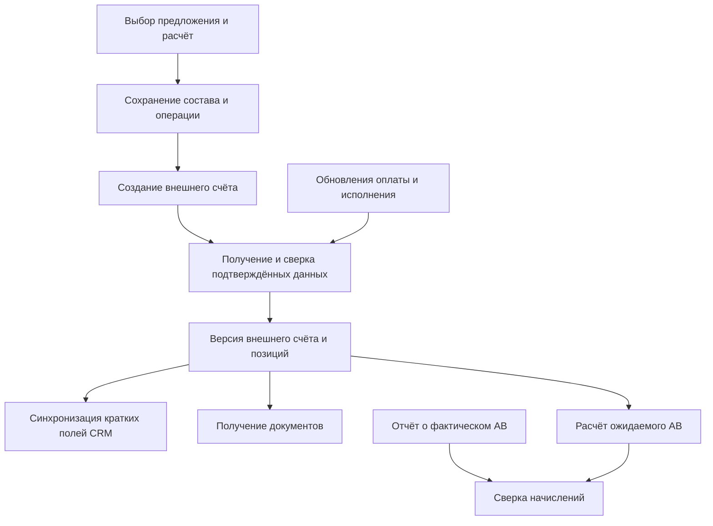

> Историческое исследование на дату в имени файла. Оно сохраняет исходные наблюдения и предложения; текущее состояние интеграции Контура описано в [инструкции](KONTUR_INTEGRATION.md).

# Полноценный учёт счетов Контура в Voovi

## 1. Цель и статус

Уточнение требований от 16.10.2026: интеграция нужна для хранения полного состава и жизненного цикла внешнего счёта, последующего расчёта АВ, получения документов и других автоматизаций. Номер, сумма и ссылка — только краткое представление этих данных в существующих таблицах CRM.

Это целевая модель и требования к будущей реализации. Миграции, обработчики и вызовы внешнего API в рамках этого уточнения не выполнялись. Подтверждённые контракты и ограничения API описаны в [исследовании Orders API](/Users/admin/Documents/Develop/Projects/SAVOIR/voovi/docs/KONTUR_ORDERS_API_2026-10-16.md). Перечисление нужного поля ниже не означает, что оно уже доступно через данный API.

**Обновление 25.10.2026:** после отдельного рабочего прогона подтверждены создание и чтение нашего пакета; шапка и прямой состав вернули 401. [Актуальный план внедрения](KONTUR_INTEGRATION.md) добавляет внешние данные к существующей группе schet, сохраняя текущие номера и связи. Эта модель — целевой набор дополнительных данных, не требование заменить существующий учёт или ввести обязательную sale-таблицу. Совместимость с приложением и внешними серверными cron-скриптами проверяется до рабочего запуска; снимки исследования пока не являются данными новых таблиц Voovi.

**Дополнение после анализа архива api_kontur:** [accounting API реально вернул наш счёт по BillId](KONTUR_ACCOUNTING_FEED_REVIEW_2026-10-25.md), включая номер, окончательную сумму, расчётные строки с налогами и пакеты. Во внешнем коде уже есть сохранение в bills, bills_tariffs, bills_tariffs_services и bills_order_packages. Перед созданием новых аналогичных сущностей проверяется их реальная схема/индексы/точность и действующий запуск импорта; недостающие история, связи и операции добавляются отдельно.

## 2. Что означает «хранить все данные»

Нужно одновременно сохранять:

1. **Структурированные сущности** для поиска, отчётов, расчёта АВ, связей и фоновой обработки.
2. **Снимки исходных данных** каталога, выбранного предложения, отправленного состава и полученных ответов. Они сохраняют свойства, которые ещё не разобраны приложением, и позволяют проверить расчёт позднее. Авторизационные заголовки и токены в снимки не входят.
3. **Файлы документов и их метаданные** с привязкой к счёту/версии, источником и контрольной суммой.

Недостаточно хранить только текущий JSON: нужна история версий и разбор основных полей. Недостаточно и текущего справочника тарифов: изменение названия, цены или правила каталога не должно переписывать исторический состав счёта.

Для каждого полученного набора данных фиксируются источник, время получения, версия/метка изменения при наличии, локальная версия формата и полнота данных. Неизвестная сумма, ставка или оплата не заменяются нулём. Ожидаемые данные запроса, предварительный расчёт и подтверждённые данные выставленного счёта хранятся раздельно.

## 3. Основные сущности

Названия ниже условные; перед миграциями нужно сверить фактические таблицы, существующие импорты и потребителей.

| Сущность | Что хранить |
|---|---|
| Профиль интеграции | Площадка, партнёр/СЦ, доступные возможности, ссылка на серверный секрет |
| Внешний счёт | Собственный локальный ID, billId, номер, даты, плательщик, продавец, партнёр, реквизиты, валюта, суммы, состояния, версия, источник и время синхронизации |
| Позиция / пакет | orderPackageId, productId, tariffId, тип, снимок наименования, свойства, количество/единица при доступности, сроки, сценарий, получатель, ЛС, связь с основным пакетом и модификаторами |
| Цена и скидки позиции | Исходная и итоговая стоимость, сумма без налога/налог при наличии, ставка при наличии, открытая цена, ручные/автоматические скидки и акции, распределение скидки комплекта |
| Клиент и лицевой счёт | Соответствия ogrn ↔ abonentId; productId/accountId, плательщик и получатели; снимки реквизитов на момент операции |
| Каталог и соответствия | Внешние продукты/тарифы, версии и доступность; соответствия локальных услуг внешним тарифам/наборам |
| Связь с CRM | Внешний счёт ↔ бизнес-группа schet по rand; при необходимости соответствие конкретных позиций, без зависимости только от изменяемого schet.id |
| История состояния | Раздельные события выставления, оплаты, активации/доставки, исправления, аннулирования/возврата — если соответствующие данные доступны |
| Документ | Тип, внешний ID, номер/дата, связь с версией счёта, формат, источник, состояние получения, файл, размер, hash, версия и время получения |
| Правило АВ | Продукт/тариф/свойства, роль, сценарий, условия, период действия, база, ставка/фиксированная сумма, версия правила |
| Расчёт АВ | Счёт и позиции, версия исходных данных и правил, входные факты, база, результат по ролям, округление, состояние, объяснение и история пересчётов |
| Фактическое начисление | Строка отчёта/реестра, период, основание, сумма, роль, продукт, корректировки, источник и связь с ожидаемым расчётом |
| Операция интеграции | Тип операции, сохранённые GUID и состав, ключ защиты от повтора, состояние, попытки, ошибки, неопределённый результат и восстановление |

### Структура позиций

Внешний счёт может содержать несколько продуктов, получателей и вложенных модификаторов. Поэтому нельзя ограничиться плоской связью «один счёт = один tarif.id».

Нужно различать GUID нового приобретаемого пакета и GUID прежнего пакета, участвующего в докупке/смене/досрочном продлении. Обычное продление в API использует Create, но бизнес-классификация для АВ может требовать дополнительных исторических фактов. Локальный shetold сам по себе их не подтверждает.

Количество сохраняется в том представлении, которое подтвердил внешний источник: единицы/пакеты/оптовое количество. Нельзя придумывать quantity для express-формы, где оно не объявлено. Для дальнейшего расчёта потребуется однозначное правило сопоставления внешних пакетов с количествами и локальными строками.

### Связи и деньги

Не закладывать ограничение «только один внешний счёт на один внутренний»: нужны история перевыставлений и возможность явной связи нескольких документов. Окончательную допустимую кратность связей необходимо определить по бизнес-сценариям. Распределение сумм между связанными счетами/позициями хранится явно, если оно требуется; одну внешнюю сумму нельзя дважды включить в расчёт АВ.

Денежные значения хранятся Decimal с точностью, соответствующей контракту, без float; валюта и точность исходного значения сохраняются. Цена/база может требовать большей точности, чем конечная сумма к выплате. Правила округления должны входить в версию расчёта. Итоги шапки сверяются с позициями, скидками и налогами, а не молча подменяются локально вычисленной суммой.

## 4. Исходные данные для автоматического расчёта АВ

Полный состав счёта необходим, но сам по себе ещё не определяет вознаграждение. В изученной спецификации Orders API не найден контракт выдачи правил или начислений АВ. Они должны поступать из согласованных правил партнёра, отчётов или другого подтверждённого источника.

| Группа | Нужные факты |
|---|---|
| Основание | Счёт, конкретные пакеты/тарифы, продукт, свойства и услуги |
| Продажа | Первичная/продление/докупка/смена, предыдущие пакеты, история клиента при необходимости |
| Роль | Роль СЦ/партнёра и ответственные участники; не выводить автоматически из автора счёта |
| Денежная база | Цена до/после скидки, налог, исключаемые товары/услуги; какую именно базу брать, определяет правило |
| Условия признания | Какие события дают право на АВ: оплата, активация, поставка и т. п.; условия должны быть утверждены, а не угаданы по одному флагу |
| Период | Даты продажи, оплаты, исполнения и расчётный период по выбранному правилу |
| Правило | Версия, срок действия, ставка/фиксированная часть, ограничения, акции и исключения |
| Корректировки | Снятие оплаты, возврат, перевыставление, перерасчёт и ручная корректировка с причиной |

Не закладывать одну универсальную формулу «сумма счёта × процент». Нужен расчёт по подходящим позициям и ролям, с объяснением: какие строки включены, какая база использована, какое правило применено и почему получился результат.

Разделить результаты:

- **Ожидаемое АВ** — наш воспроизводимый расчёт по известным фактам и правилам.
- **Фактическое начисление** — данные отчёта/реестра Контура или другого согласованного подтверждения.
- **Разница** — сумма и причина расхождения; отсутствие фактического начисления не означает нулевое начисление.

Повторный импорт/пересчёт не создаёт вторую выплату. Результат связывается с версиями данных и правил. Новый расчёт сохраняется отдельной версией; подтверждённые начисления не переписываются без истории. Начисление, подтверждение и выплата — отдельные состояния, если выплаты входят в дальнейшую автоматизацию.

Если не хватает роли, правила, состава или подтверждения оплаты, результат отмечается как неполный/требующий проверки. Это предотвращает ложную точность автоматического расчёта.

## 5. Документы

Документы — отдельная часть модели, а не одна ссылка в счёте. Для каждого документа нужны тип и идентификатор источника, связь со счётом/версией, номер/дата, формат, статус доступности, попытки получения и сохранённый файл с hash.

В целевых сценариях могут потребоваться счёт, договор, акт, накладная, УПД, приложения и подписанные версии. Их доступность и источник нужно подтвердить отдельно: текущая документация Orders API не описывает весь этот набор и скачивание PDF. Документы из Диадока/Эврики и печатные формы Voovi нельзя автоматически считать одним документом или одной версией.

Получение повторяется при временной недоступности; одинаковый файл не дублируется, изменившаяся версия сохраняется отдельно. Браузерная ссылка и адрес скачивания могут иметь иной срок жизни, чем сохранённый документ. При отсутствии доступа к скачиванию показывается это состояние, а не фиктивный файл.

В интерфейсе нужна вкладка документов со списком и состояниями: доступен, ожидается, ошибка получения, заменён новой версией. По мере поддержки источников добавляются подлинники и подписи.

## 6. Автоматизации и независимые состояния

Целевой процесс:

Это целевая схема; источники чтения, оплаты, документов и начислений ещё должны быть подтверждены.

Выставление, оплата, активация/доставка, документы, синхронизация и АВ имеют отдельные состояния. Успешный POST не означает, что оплачено, документы готовы или вознаграждение начислено.

Фоновые задания работают с сохранёнными операциями и событиями: получают изменения, сверяют данные, скачивают документы, запускают нужный пересчёт, сверяют реестр. Повторная обработка одного события не создаёт дубликатов. Транзакция БД не держится открытой во время сетевого вызова. События, требующие обработки, фиксируются вместе с локальными изменениями, чтобы сбой не терял последующую автоматизацию.

Для неопределённого результата создания сохраняется прежний billId и запрос. После подтверждения восстанавливается связь, а не создаётся новый счёт. Изменение состава после создания требует отдельного поддерживаемого сценария корректировки/перевыставления.

## 7. Что уже есть в коде и что нужно согласовать с этим

Дополнительно к ручным полям schet найдены следующие модели и обработчики:

| Участок | Фактическое содержание |
|---|---|
| `bills`, модель Bills | Внешние BillId/Number/Amount/State/OrderId, плательщик, партнёр/менеджеры, даты оплаты и другие реквизиты; модель не содержит полного тарифного дерева |
| `BillsInfoView` | Ищет внешнюю запись по отображаемому номеру, отдаёт последнюю по id |
| `task_update_data_av` | Сопоставляет bills и schet по номеру, обновляет priceks, затем реквизиты av; не является движком расчёта вознаграждения по внешним позициям |
| `av` | Основные/дополнительные продукты и услуги, роли, количество сертификатов, номер и сумма, связь rand |
| `avkontur` | Поля базы начисления, ставки, суммы АВ, роли, вида продажи, периода, продукта, дополнительных начислений/штрафов |
| `analitic/utils/skbpasre.py` | Разбор табличного отчёта и запись начислений/доплат/штрафов в avkontur |
| `av_ci`, модель AvCi | Сумма АВ, дата начисления и связь с rand; одна модель не подтверждает весь порядок её использования |

Источники: [модели АВ](/Users/admin/Documents/Develop/Projects/SAVOIR/voovi/s.voovi.ru-api/basic/models.py:81), [Bills](/Users/admin/Documents/Develop/Projects/SAVOIR/voovi/s.voovi.ru-api/basic/models.py:157), [синхронизация](/Users/admin/Documents/Develop/Projects/SAVOIR/voovi/s.voovi.ru-api/basic/tasks.py:35), [чтение Bills](/Users/admin/Documents/Develop/Projects/SAVOIR/voovi/s.voovi.ru-api/basic/views.py:1192), [импорт отчёта АВ](/Users/admin/Documents/Develop/Projects/SAVOIR/voovi/analitic/utils/skbpasre.py:15).

Это результаты чтения кода, без запуска задач и без проверки полноты/актуальности таблиц. Источник загрузки bills и весь порядок использования av_ci требуют отдельного разбора перед реализацией. В Django-модели Bills.amount объявлен без десятичных знаков; денежную точность реальной БД и импорта нужно проверить до повторного использования.

Существующие таблицы нельзя ни автоматически считать достаточными, ни дублировать без анализа. Нужны общий источник истины и переходный план: сохраняем совместимость потребителей schet/av/bills, а новые функции работают со структурированным внешним счётом и проверенными начислениями. Фоновая старая синхронизация не должна перезаписывать новые подтверждённые данные устаревшим импортом.

## 8. Требования к доступу и качеству данных

До полного проектирования контрактов нужно подтвердить получение:

- шапки и идентификаторов счёта;
- полного состава пакетов, модификаторов, свойств, цен и скидок;
- плательщика, получателей, ЛС, сроков и сценариев;
- изменений оплаты/исполнения и корректировок;
- документов и их версий;
- правил/оснований расчёта АВ и фактических начислений из согласованных источников.

Отправленный нами JSON покрывает намерение выставления, но не доказывает итоговый состав и фактическое исполнение внешней системой. Нужна сверка с подтверждённым источником. Если источник скрывает часть данных, сохраняется признак неполноты; такие данные не используются для автоматического финального начисления.

## 9. Этапы и критерии готовности

1. **Инвентаризация:** разобрать bills/av/avkontur/av_ci, импорты и действующие правила АВ; подтвердить доступные API и документы. Результат — карта источников и полей, без параллельных противоречащих хранилищ.
2. **Модель полного счёта:** версии шапки/позиций, снимки, клиенты/ЛС, цены, роли, соответствия, документы и операции. Она нужна уже при первом создаваемом счёте, а не добавляется после нескольких месяцев хранения только номеров.
3. **Создание и синхронизация:** восстановление после сбоев, сохранение всех позиций/свойств, подтверждение состава и контроль изменений, совместимость старых экранов.
4. **Ожидаемое АВ:** утверждённые версии правил и воспроизводимый расчёт по позициям/ролям с объяснением и статусом полноты.
5. **Сверка и документы:** получение файлов, импорт фактических начислений, контроль расхождений и корректировок; запуск фоновых действий по событиям.

Полноценная интеграция готова, когда исторический состав можно восстановить независимо от текущего каталога; повтор не создаёт второй счёт/начисление; расчёт АВ объясним и сверяется с фактом; документы связаны с правильной версией; неизвестные/недоступные данные видны пользователю. Заполненные номер и ссылка сами по себе этим критериям не соответствуют.
