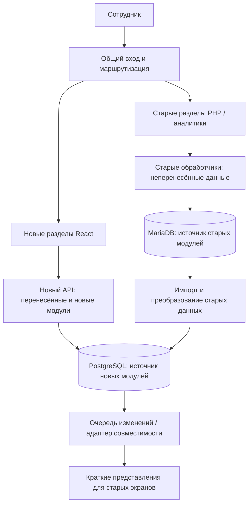

> Историческое исследование на дату в имени файла. Оно сохраняет исходные наблюдения и предложения; текущее состояние интеграции Контура описано в [инструкции](KONTUR_INTEGRATION.md).

# Voovi: решение о переходе на React и PostgreSQL

Дата: 16.10.2026. Основание — исследование текущего рабочего дерева, локальной структуры БД и ранее разобранных процессов. Это архитектурная рекомендация; production-нагрузка, доступное окно простоя, состав команды и сроки не измерялись. Приложения и базы в рамках этой оценки не изменялись.

Дополнительно рассмотрена эволюция текущего продукта с одной рабочей MariaDB: перенос интерфейса и бизнес-операций за API, улучшение схемы в той же БД и отдельное последующее переключение на PostgreSQL. Это полноценная альтернатива, отличная от одной лишь замены экранов. При приоритете непрерывного развития и небольшой команде она может оказаться проще длительного сосуществования двух БД. См. [поэтапное развитие на текущей БД](/Users/admin/Documents/Develop/Projects/SAVOIR/voovi/docs/IN_PLACE_MODERNIZATION_2026-10-16.md).

## 1. Рекомендация

**Новую систему писать отдельно, с новой предметной моделью и PostgreSQL; переводить эксплуатацию в неё последовательно, законченными модулями.**

Из варианта «с нуля» берём отдельный код, поддерживаемый стек, нормальную схему и единые правила. Из постепенного перехода — раннее использование новых функций, проверяемую миграцию и ограниченное переключение процессов.

Постоянная свободная запись одних и тех же бизнес-данных из двух приложений в две базы не подходит. У каждого набора данных в каждый момент должен быть один ответственный модуль и один источник истины. Вторая копия может быть импортом для чтения или представлением для совместимости; у неё нет независимого права менять исходный факт.

Новый проект не должен автоматически переносить SQL, cookie-авторизацию и managed=False-модели старого проекта. Проверенные алгоритмы можно переносить после выделения и тестирования, не импортируя старое приложение с его startup-эффектами.

## 2. Почему именно для Voovi

| Наблюдение | Значение для перехода |
|---|---|
| Три приложения напрямую работают с одной БД | Перенос одного экрана не переносит ответственность за данные |
| PHP 5.6, Django 3.2, MariaDB 10.2 | Новую основу разумно отделить от старого окружения; безопасность работающей системы нужна уже во время перехода |
| 122 таблицы в исследованном дампе; 111 колонок schet | Это несколько связанных бизнес-процессов, а не только замена интерфейса |
| В schet позиции смешаны с повторяемой шапкой и итогом | Нужна новая модель счёта и явное преобразование, не копирование таблицы |
| Есть строковые суммы/даты, MyISAM и логические связи без FK | Простое изменение СУБД не исправляет данные и не добавляет атомарности старым операциям |
| PHP, API, фоновые задачи и импорты меняют суммы/статусы | При переключении нужно обнаружить и отключить всех старых писателей конкретных данных |
| Некоторые просмотры создают служебные записи | Даже «оставить старый экран только для просмотра» требует проверки |
| Расчёты формы, карточки, API и PDF различаются | Новая система должна иметь утверждённые правила; равенство старому поведению не всегда правильный критерий |
| В локальной истории есть неоднозначные номера и разные суммы внутри групп | Перед введением ограничений PostgreSQL нужна сверка и разрешение неоднозначностей |
| Касса, документы, оплата, склад и АВ связаны со счетами | Нельзя безопасно переносить финансовые функции как независимые поля |

По предыдущему исследованию: около 109 тыс. строк прикладного PHP после эвристического исключения библиотек; размер локального дампа около 514 MiB. Главная трудность — правила и связи, а не сам объём файла. Эти значения не характеризуют актуальный production и не дают оценку сроков.

Источники: [обзор проекта](/Users/admin/Documents/Develop/Projects/SAVOIR/voovi/docs/PROJECT_REVIEW_2026-10-16.md), [жизненный цикл счёта и локальные расхождения](/Users/admin/Documents/Develop/Projects/SAVOIR/voovi/docs/INVOICE_FLOW_2026-10-16.md).

## 3. Сравнение вариантов

| Подход | Преимущество | Основной риск | Вывод |
|---|---|---|---|
| Полностью написать новый сервис, затем одним переключением перенести всё | Чистая архитектура, минимум временных мостов | Поздняя проверка реальной работы, параллельное развитие старого кода, масштабный финальный переход и скрытые правила | Возможен при замороженном объёме и доступной команде; сейчас не основной выбор |
| Новые экраны поверх старой схемы | Быстро виден интерфейс | Структура, побочные эффекты и неоднородные правила сохраняются | Допустим как короткий переходный экран, не целевая архитектура |
| Новое приложение свободно пишет часть полей в PostgreSQL, часть в старую БД | Кажется быстрым способом начать | Две версии истины, частичный успех, циклы синхронизации, рост числа зависимостей | Не рекомендую как общий принцип |
| Новая система отдельно, переход по модулям с назначенным владельцем данных | Чистая целевая модель и постепенная эксплуатационная проверка | Требует временного адаптера, сверок и дисциплины отключения старых обработчиков | Рекомендованный вариант |

Рекомендация предполагает, что действующий сервис продолжает обслуживать работу и новые функции нужны до полной переписи. Если систему можно остановить/заморозить, весь объём описан и есть отдельная команда на полную замену, решение о единовременном переключении стоит пересмотреть.

## 4. React, backend и база — разные решения

React отвечает за интерфейс. Для счетов, оплат, правил доступа, расчётов, интеграций и транзакций нужен серверный слой.

Для этого проекта предлагаю:

- React + TypeScript; маршрутизация и загрузка данных выбираются явно, например React Router с Vite. Серверный рендеринг нужен только при подтверждённой задаче, а не по умолчанию для внутренней CRM.
- Новый Django API на поддерживаемой версии, с Django REST Framework совместимой версии. В качестве консервативной основы можно рассматривать 5.2 LTS с актуальным security patch и совместимым Python; официальный срок extended support — апрель 2028. Версии повторно фиксируются на старте реализации.
- PostgreSQL поддерживаемой стабильной версии; управляемые миграции, FK, уникальность, ограничения состояний и точные денежные типы.
- Один backend с модулями клиентов, каталога, продаж, финансов, документов, АВ и интеграций. Общая транзакционная БД для связанных новых операций. Разделять на микросервисы сейчас оснований нет.
- Отдельный worker/scheduler, хранилище файлов, журнал аудита, наблюдаемость и CI. Планирование задач явно управляется, не выполняется побочно при импорте приложения.

Python/Django здесь разумны из-за уже существующих серверных функций и знаний предметной области; это не означает копирование текущих views/models в новый проект. Если команда существенно сильнее в другом серверном стеке, выбор backend можно изменить без изменения стратегии миграции.

Официальные ориентиры: [варианты создания React-приложения](https://react.dev/learn/creating-a-react-app), [поддерживаемые Django-релизы](https://www.djangoproject.com/download/). Замена технологий сама по себе не обеспечивает безопасность: нужны корректная авторизация, разграничение доступа и эксплуатация.

## 5. Временная архитектура

Стрелки импорта и совместимости относятся к разным явно перечисленным наборам данных, а не к универсальной двунаправленной репликации одной сущности. Адаптер совместимости может отдавать API-ответ или ограниченно обновлять legacy-представление; конкретный способ зависит от существующих потребителей.

Новый frontend обращается только к серверному API. Между MariaDB и PostgreSQL нет обычных FK. Django также не поддерживает FK/M2M между разными БД; обычный atomic(using=...) относится к выбранной базе и не превращает две записи в распределённую транзакцию. [Ограничения multi-db](https://docs.djangoproject.com/en/5.2/topics/db/multi-db/#cross-database-relations), [транзакции Django](https://docs.djangoproject.com/en/5.2/topics/db/transactions/).

### Матрица ответственности на первом этапе

| Данные | Источник истины | Что разрешено новой системе |
|---|---|---|
| Клиенты, пока редактируются в старой CRM | MariaDB | Чтение через адаптер / односторонний импорт со связью legacy ID; сохранять снимок реквизитов для нового документа |
| Действующие старые счета и оплаты | Старый модуль | Просмотр и сверка; изменения только через согласованный старый обработчик, без второй независимой модели записи |
| Новый полный внешний счёт Контура и его пакеты | PostgreSQL | Полное управление через новый API; при необходимости передавать краткое представление в старую CRM |
| Новые версии расчёта ожидаемого АВ | PostgreSQL | Расчёт и история; старые подтверждённые начисления пока импортируются как факты из действующего источника |
| Документы новой интеграции | Новый модуль + файловое хранилище | Файлы/версии/состояния; старые экраны получают ссылку/состояние |
| Внутренние продажи после переключения модуля | PostgreSQL | Новые операции только через новый API; старые пути записи отключены/перенаправлены |

Матрица задаётся по данным, а не только по названиям таблиц. Например, новые подтверждённые данные внешнего счёта и старый редактируемый внутренний счёт — разные сущности, даже если legacy-экран показывает их рядом.

## 6. Когда запись в две базы допустима

Пример допустимого процесса:

1. Новый backend сохраняет полный внешний счёт, пакеты, снимки и событие обновления **в одной транзакции PostgreSQL**.
2. Worker читает сохранённое событие и обновляет разрешённые краткие поля старого представления.
3. При ошибке событие остаётся для повтора; видны состояние и задержка синхронизации. Повтор не создаёт новую сущность.
4. Старый код не редактирует эти краткие поля независимо и не запускает для них конфликтующую синхронизацию.

Это хранение оригинала и производной копии. При их расхождении источник истины заранее определён. Если старый процесс требует строго актуальную копию перед действием, он запрашивает/проверяет её; финансовое действие нельзя продолжать на заведомо устаревших данных.

Пример недопустимого общего правила: сохранить оплату в MariaDB и начисление/отгрузку в PostgreSQL двумя обычными INSERT, затем считать весь запрос атомарным. При сбое одной записи бизнес-операция распадается.

Функции, требующие общей атомарности, переносятся вместе. Если временный процесс вынужденно проходит через две системы, это отдельный явно спроектированный сценарий с состояниями, повторами и восстановлением; не скрытый побочный эффект кнопки «Сохранить».

Для старого MyISAM нельзя обещать транзакционную запись события вместе с бизнес-изменением. Пока старые пути не изменены, нужны сверяемый импорт, управляемая остановка записи или отдельно проверенный механизм захвата изменений.

## 7. Что переносить первым

### Этап 0. Сделать переход безопасным для текущей работы

Резервная копия с проверенным восстановлением, изоляция окружений и секретов, отказ от удалённых fallback-подключений. Исправить подтверждённую проверку cookie после view, критические проверки доступа и наиболее опасные SQL-пути. Длительность переписи не оправдывает сохранение известных уязвимостей в работающей системе.

Нужно разделить аутентификацию и права. Общий интерфейс входа допустим, но нельзя просто скопировать старые id/hash-cookie и считать новую систему защищённой. Нужен новый проверяемый серверный контур сессий/SSO и явный переходный механизм для legacy, проверка прав до выполнения действия, права на организацию/отдел/объект, аудит изменений и защита изменяющих запросов.

### Этап 1. Основа нового проекта и карта перехода

Создать отдельные код/окружение, API, PostgreSQL, миграции, CI, роли и аудит. Зафиксировать таблицы/обработчики/задачи, кто меняет каждую группу данных, и бизнес-инварианты. Начать пробные миграции сразу, не откладывать перенос данных до завершения всех экранов.

### Этап 2. Первый законченный новый процесс

Полный внешний счёт Контура, его тарифы/пакеты, история, документы и ожидаемое АВ — подходящий кандидат: это новая функция, для неё уже спроектирована отдельная предметная модель. Клиенты пока приходят из старого источника. Краткие поля старых экранов обслуживаются адаптером.

Если не подтверждены API-права Контура, можно готовить модель, импорт, просмотр и локальный расчёт по проверенным данным. Полный цикл создания/сверки/документов не объявляется готовым до подтверждения контрактов. Отсутствие внешнего доступа не должно определять всю стратегию модернизации.

Источник требований: [модель счёта Контура, АВ и документов](/Users/admin/Documents/Develop/Projects/SAVOIR/voovi/docs/KONTUR_BILLING_DOMAIN_2026-10-16.md).

### Этап 3. Каталог, клиенты и внутренние продажи

Переносить справочники с сохранением версий и связей. Переход владения клиентами требует отключения старых редакторов, импортов и интеграций, которые их меняют. До этого PostgreSQL содержит их копию для чтения, а не второго хозяина.

Внутренний счёт переносить как шапку, позиции, версии, документы, статусы и связанные команды. Старые `.first()`/GROUP BY и повторение price не становятся новой моделью. Оплаты и распределения нельзя отрезать от счёта без определённого контракта; конкретный размер этого этапа зависит от карты транзакционных зависимостей.

### Этап 4. Финансы, склад и касса

Счёт/платёж/распределение/возврат/остатки должны иметь согласованные инварианты. Склад и касса переводятся после проверки связей с продажей, внешним агентом и исполнением команд. Нужны защита от повторов и сверка внешних результатов.

Не запускать две кассовые команды, две отправки документа или два создания внешнего счёта ради сравнения систем. Сравниваются чтение, подготовленные payload и расчёт; реальное внешнее действие имеет одного исполнителя.

### Этап 5. Отчёты, история и завершение

После появления надёжных новых данных переводить зависимые отчёты, расчёты АВ/зарплаты и оставшиеся экраны. Старые фактические начисления не заменять автоматически новым ожидаемым расчётом. Завершить перенос нужной истории и архивирование исходных данных, удалить последние живые зависимости.

Каждый этап заканчивается сокращением старой ответственности, а не только появлением нового экрана. Нужны критерии выхода из переходного режима и ответственный за отключение старого пути.

## 8. Как переносить данные

### Не делать перенос 122 таблиц один к одному

Сначала целевая схема: отдельные шапка и позиции счёта, версии тарифов и документов, типизированные деньги/даты, отдельные статусы и распределения оплаты, FK и ограничения внутри PostgreSQL. JSONB используется для исходных/расширяемых данных, а не вместо всех связей и финансовых полей.

Постоянная таблица соответствий хранит источник/таблицу/старый ключ → новый ID. Номера счетов сохраняются строками и не перевыпускаются. Сопоставление по одному ns ненадёжно: в локальном историческом наборе обнаружены 123 ненулевых ns, общих нескольким rand. Точные правила выделения бизнес-группы требуют проверки rand, позиций и связанных сущностей.

### Повторяемый импорт

1. Сохранить исходный снимок и метаданные загрузки.
2. Загрузить в промежуточный слой без потери оригинальных значений.
3. Преобразовать по версионированным правилам и записать соответствия ключей.
4. Неоднозначные записи помещать в очередь разбора, а не терять или склеивать автоматически.
5. Сверить группы, суммы, связи и остатки.
6. Повторить на свежем наборе и измерить длительность переключения.

Частные случаи: нулевые даты и пустые строки, точность сумм, разделители/пробелы, часовые пояса, soft delete, сменившиеся ID позиций, дубли шапки, старые версии тарифов, файлы и права на них. Потерянные старой системой данные нельзя выдумывать: сохраняются исходное значение и статус неизвестности.

Исторические документы сохраняются файлами, если доступны. Их повторная генерация по текущим реквизитам/ставкам может не воспроизвести оригинал. Расчётные расхождения должны разбираться, а не маскироваться общей суммой импорта.

### Доставка изменений до переключения

Для начала подходят управляемые повторные загрузки и согласованное окно запрета записи. Если нужное окно слишком короткое, отдельно проектировать инкрементальную доставку/CDC. До выбора инструмента проверить поддержку фактической MariaDB 10.2, MyISAM, binlog, удаления и согласованного начального снимка. Максимальный id или дата без гарантированного учёта UPDATE/DELETE недостаточны.

Логическая репликация PostgreSQL не является готовым преобразователем старой схемы Voovi в новую. Даже внутри PostgreSQL DDL и состояние последовательностей не переносятся автоматически. [Ограничения логической репликации](https://www.postgresql.org/docs/current/logical-replication-restrictions.html).

Для смешанных MyISAM/InnoDB не обещать согласованность активного дампа только за счёт одной транзакции: режим получения снимка согласовать с эксплуатацией и механизмом захвата изменений.

## 9. Как переключать модуль

Перед передачей ответственности должны быть готовы:

- сверенные бизнес-сценарии, роли и данные;
- список всех старых точек записи: PHP, оба Django-приложения, фоновые задачи, импорты и интеграции;
- однозначные ID и зависимости, совместимость необходимых старых читателей;
- наблюдаемая очередь событий и процедура разбора ошибок;
- репетиция импорта, конечная сверка и план восстановления.

Само переключение: запрет старых изменений выбранного набора данных → остановка его старых задач/импортов → получение последних изменений → сверка → смена маршрутов команд и доступов → открытие новой записи → наблюдение и сверка производных представлений. Отсутствие кнопки в старом UI не заменяет запрет на серверном endpoint.

Если решено переключать только часть записей, например счета определённого подразделения или новые после даты, это требует доказуемой маршрутизации всех команд и задач по владельцу. В текущем Voovi с прямым SQL такой разрез может оказаться дороже переноса модуля целиком; его нельзя обещать по умолчанию.

Откат до открытия новой записи сравнительно прост. После появления новых операций нельзя просто вернуть старый интерфейс или старую копию БД: новые данные и внешние действия уже существуют. Нужен проверенный обратный перенос/повтор событий либо временная остановка и исправление нового пути. Граница отката фиксируется заранее.

## 10. Что проверять до признания этапа готовым

| Проверка | Критерий |
|---|---|
| Миграция | Исходные записи учтены, неоднозначности перечислены; повтор не создаёт дубликаты |
| Деньги | Сходятся утверждённые итоги по счёту, оплаты/возвраты/распределения и остатки; расхождения объяснены |
| Нумерация и связи | Исторические номера сохранены, новые номера не конфликтуют, документы/товары/платежи привязаны верно |
| Расчёты | Набор реальных обезличенных сценариев, независимые ожидаемые результаты, версии правил и округлений |
| АВ | Ожидаемое отдельно от факта; изменения правил/повторный импорт не дублируют начисление |
| Права | Отказ до побочного действия, права на конкретную организацию/отдел/объект, ограниченные поля команд |
| Конкурентность | Двойное нажатие, повтор запроса и параллельные сотрудники не удваивают платёж/счёт/кассовую команду |
| Сбои | Восстановление между локальной записью и внешним результатом; видимые ошибки и повторы |
| Совместимость | Старые читатели получают согласованные данные; старые писатели перенесённого модуля отключены |
| Эксплуатация | Проверены backup/restore, наблюдаемость и переключение, измерено допустимое окно |

Старое поведение используется как свидетельство, а не безусловная спецификация. Например, повторяющийся итог price нельзя суммировать по позициям и нельзя сохранять ошибочный зелёный статус частичной оплаты только ради совпадения экранов. Исправления бизнес-поведения утверждаются отдельно и проверяются явными примерами.

## 11. Когда выбрать полную замену одним запуском

Этот вариант становится предпочтительнее, если команда может поддерживать старый сервис и параллельно довести новый до всего необходимого объёма; процессы описаны и стабилизированы; есть репетиции полной миграции, окно переключения и план работы при сбое; изменения старого функционала ограничены. Тогда временные адаптеры могут стоить больше, чем один переход.

Сейчас наличие многочисленных неявных правил и прямых записей нескольких приложений говорит в пользу последовательной проверки и переноса. Это инженерный вывод по исследованному коду, а не универсальная оценка любой переписи.

Точная стоимость зависит от команды, списка реально используемых сценариев, качества production-данных, допустимого простоя и доступности внешних API. Оценка в неделях без этих данных была бы необоснованной. Первое измеримое задание — карта владельцев данных и пробный перенос выбранного сквозного сценария с отчётом сверки.
