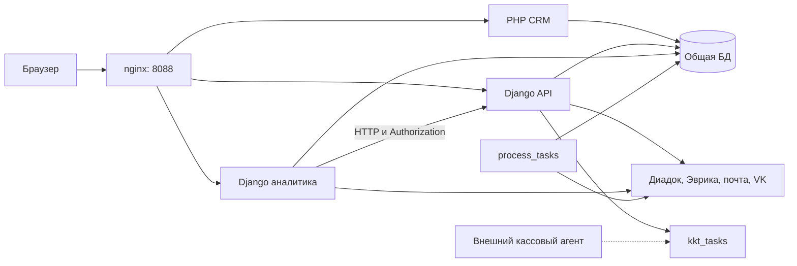

> Историческое исследование на дату в имени файла. Оно сохраняет исходные наблюдения и предложения; текущее состояние интеграции Контура описано в [инструкции](KONTUR_INTEGRATION.md).

# Voovi: устройство проекта и результаты исследования

Дата исследования: 16 октября 2026 года. Рабочая директория: `/Users/admin/Documents/Develop/Projects/SAVOIR/voovi`.

## 1. Что представляет собой система

Voovi — внутренняя CRM и учётная система: организации и контакты, продажи и счета, оплаты и возвраты, касса, склад, документы, агентские начисления и зарплата. В коде присутствуют процессы продажи продуктов Контура, электронных подписей, маркировки и кассовых услуг.

Архитектурно это три приложения с общей предметной областью и общей MySQL-совместимой БД. Границы приложений не совпадают с границами владения данными: PHP, API и аналитика напрямую читают и изменяют одни и те же таблицы. Поэтому систему полезно рассматривать как несколько тесно связанных приложений над общей схемой, а не как независимые микросервисы.

| Часть | Роль | Основные технологии |
|---|---|---|
| Корневой репозиторий | Подключение приложений и запуск окружения | Git submodules, Docker Compose, shell, nginx |
| `voovi.ru` | Основной интерфейс CRM, вход, карточки клиентов и счетов, тарифы | PHP 5.6, Apache, `mysql_*`, HTML/CSS, jQuery |
| `s.voovi.ru-api` | JSON API, документы, расчёты, складские операции, очередь команд кассы | Python 3.9, Django 3.2.8, DRF 3.12.4 |
| `analitic` | Интерфейс платежей, отчёты, зарплата, касса, склад, интеграционные экраны | Python 3.9, Django 3.2.3, Django templates, jQuery |
| `db` | Локальная общая БД | MariaDB 10.2 |
| `svoovi-api-tasks` | Исполнитель фоновых задач приложения API | `django-background-tasks`, команда `process_tasks` |



Кассовый агент обозначен как внешняя зависимость: в изученных исходниках найден код создания и чтения команд `kkt_tasks`, но не исполнитель команд открытия/закрытия смены. Его поставка не описана отдельным сервисом корневого Compose.

## 2. Объём и границы исследования

Проверены Compose-файлы, Dockerfile, скрипты запуска и восстановления, настройки Django, маршруты, middleware, модели, сериализаторы, ключевые обработчики счетов/платежей/склада/кассы, генерация документов, фоновые задачи и интеграционные модули. Дополнительно изучены PHP-точки входа, создание идентификаторов счетов и версионирование тарифов.

| Измерение | Результат |
|---|---:|
| PHP-файлы в дереве `voovi.ru`, включая библиотеки | 640 |
| Строки PHP, включая библиотеки | около 240 300 |
| PHP после эвристического исключения известных библиотек и runtime-каталогов | 311 файлов, около 108 765 строк |
| Python-файлы API без `.venv` и кешей | 53, около 16 837 строк |
| Python-файлы аналитики без `.venv` и кешей, включая архивные версии | 70, около 13 502 строк |
| Модели API | 114, все `managed=False` |
| Модели аналитики | 123, из них 122 с `managed=False` |
| Общие имена моделей в двух приложениях | 113 |
| Маршруты в `basic/urls.py` API | 74 |
| Маршруты аналитики по модулям | payments: 35; reports: 30; warehouse: 11; different: 7 |
| Таблицы в корневом `voovi.sql` | 122 |
| Движки таблиц в дампе | 88 InnoDB и 34 MyISAM |
| Размер корневого дампа | около 513,7 MiB |

Метрики относятся к рабочему дереву, а не только к отслеживаемым Git-файлам. Исключение PHP-библиотек эвристическое. Размеры не означают, что каждая строка прочитана вручную: большой код исследован через структуру, вызовы и основные сценарии.

При исследовании приложения и бизнес-данные не изменялись. Структура нескольких таблиц прочитана только из локального контейнера `db`; к удалённым БД обращения не выполнялись. Значения найденных секретов в этот документ не включены.

## 3. Репозитории и источники конфигурации

Корень содержит три submodule. Их URL и рекомендуемые ветки перечислены в [.gitmodules][submodules]. В рабочем дереве все три приложения находятся на ветке `prod/2`; текущие HEAD отличаются от gitlink-коммитов, записанных родительским репозиторием. В аналитике также есть исходно присутствовавшие неотслеживаемые файлы. Их состав не изменялся в рамках исследования.

Есть несколько конкурирующих вариантов запуска:

1. Корневые `docker-compose.yml` и `dev.sh` собирают всё окружение.
2. В каждом приложении есть собственные Compose-файлы; старые README описывают отдельную Docker-сеть `net`.
3. Актуальное корневое окружение использует сеть `voovi` и `configs/env/local.env`.
4. Обновлено 25.10.2026: настройки Python-приложений перенесены в общие `configs/env/local.env` и `prod.env`. Табличные справочники и списки оставлены в Python. Загрузка YAML-конфигурации удалена. Вложенные Compose-файлы тоже подключают общий env, сохраняя прежние локальные overrides.

Для воспроизводимости важен не только commit одного приложения, а комплект: три gitlink-коммита, версия схемы/дампа, конфигурация и версия внешнего кассового агента.

## 4. Запуск и эксплуатация

### Локальное окружение

[Корневой Compose][compose-local] описывает БД, одноразовый импорт, PHP, API, worker, аналитику, nginx и phpMyAdmin. Приложения подключены bind mount, поэтому изменения исходников видны контейнерам без копирования. Django запускается через `runserver`, PHP — через Apache.

Текущие адреса после предшествующего запуска:

| Сервис | Адрес |
|---|---|
| Основная CRM через nginx | `http://voovi.localhost:8088` |
| API через nginx | `http://s.voovi.localhost:8088` |
| Аналитика через nginx | `http://analitic.voovi.localhost:8088` |
| PHP напрямую | `http://localhost:8080` |
| API напрямую | `http://localhost:7005` |
| Аналитика напрямую | `http://localhost:7001` |
| phpMyAdmin | `http://localhost:8081` |
| MySQL с хоста | `127.0.0.1:3308` |

Для общей cookie-авторизации нужны домены `*.voovi.localhost`. PHP выставляет cookie на `voovi.localhost`; соседние приложения используют их же. Номера портов не входят в cookie domain.

В текущем локальном env обе группы параметров — `DB_*` для PHP и `SQL_*` для Django — указывают на `db / voovi`. `MYSQL_*` описывают контейнер БД и импорт. Согласованность этих трёх групп нужно проверять перед любыми миграциями или восстановлением.

### Восстановление базы

Обновлено 30 октября: [`./dev.sh` без аргументов][dev] и `./dev.sh start` сохраняют текущую базу. Только явный `./dev.sh restore-db` запускает [скрипт импорта][restore]: он выполняет `DROP DATABASE`, создаёт БД и импортирует `voovi.sql`.

- `./dev.sh start` запускает сборку и приложения без повторного импорта.
- `./dev.sh stop` останавливает сервисы.
- `./dev.sh down` удаляет контейнеры и сеть, сохраняя volume БД.
- `./dev.sh restore-db` повторно импортирует дамп с удалением базы.

При первом запуске с пустым volume нужно явно выполнить `./dev.sh restore-db`. Сервис `db-restore` вынесен в профиль `tools`, приложения ожидают только готовности БД. Обычный запуск Compose не импортирует дамп.

У БД есть healthcheck. Для приложений отдельных healthcheck нет: `service_started` подтверждает запуск процесса, а не готовность HTTP или совместимость схемы.

### Production

Фактический [production Compose][compose-prod] отличается от корневого README:

- содержит только PHP, API, API worker и аналитику;
- не поднимает БД, nginx и phpMyAdmin;
- использует внешнюю БД из env;
- публикует loopback-порты `18080`, `18001`, `18002`;
- объявляет volume `voovi_mysql`, но не подключает его ни к одному сервису;
- оставляет Django `runserver`, для аналитики — `--insecure`;
- [конфигурация production nginx][nginx-prod] лежит в репозитории, но этим Compose никуда не монтируется.

Следовательно, внешний reverse proxy и внешняя БД — обязательная часть реального развёртывания, которую нельзя восстановить только по README. Окружения также используют одно имя сети `voovi`, а PHP-контейнер — одно имя `voovi_web`; параллельный запуск dev/prod на одном Docker-хосте не изолирован именами.

## 5. PHP CRM: точки входа и главные сущности

Основной интерфейс построен из отдельных PHP-страниц с HTML, JavaScript и SQL в одном файле. Централизованного маршрутизатора и общего слоя доступа к данным для всего приложения не найдено. Крупнейший прикладной файл `tablschetosn.php` содержит около 14 058 строк; `komnete.php` — около 5 129.

| Файл | Назначение |
|---|---|
| [index.php][php-login] | Форма входа, проверка логина/пароля, выдача `id` и `hash` |
| [check.php][php-check] | Проверка cookie, стартовый экран и доступные организации/подразделения |
| `kartklient.php`, `kartklientred.php` | Карточка организации/клиента и редактирование |
| `newschet.php`, `myogrn.php`, `otherogrn.php` | Создание счёта для существующего или нового контрагента |
| `tablschet.php`, `tablschetosn.php` | Списки и представления счетов |
| `komnete.php` | Подробная работа со счётом: статусы, документы, оплата и связанные действия |
| `schet.php`, `docpage.php`, `invoice_action.php` | Представление счёта, документы и действия |
| `new_tarif.php`, `old_tarif.php`, `tarif_identity.php` | Создание, версии и архивирование тарифов |
| `header.php`, `footer.php`, `style.css` | Общий интерфейс; значительный объём общего JavaScript находится в PHP-шаблонах |

В репозитории есть встроенные копии PHPExcel, PHPWord, PHPMailer, phpqrcode, редакторов и JS-плагинов. Файлы внутри `server/` и отдельные `test*.php` не следует автоматически считать самостоятельными production-сервисами: корневой запуск их не выделяет.

### Нумерация счетов

[`schet_identity.php`][schet-identity] централизует выдачу номера. Он блокирует `schetnum` и читает `schet`, сравнивает счётчик с максимумом существующих номеров, нормализует двух- и четырёхзначный год и формирует:

- `kolichschet` — последовательный номер;
- `ns` — составной бизнес-номер из года, пользователя, отдела и последовательности;
- `rand` — внутренний идентификатор группы строк счёта.

Поэтому номера нужно рассматривать как строки, а не числа для арифметики. При создании используются `myogrn.php` и `otherogrn.php`; обработка отказа в `otkazschet.php` также вызывает этот механизм.

### Версионирование тарифов

[`tarif_identity.php`][tarif-identity] разделяет постоянную сущность `tarif_parent` и версии `tarif`, связанные через `sync_id`. Создание новой версии не равнозначно изменению старой строки тарифа. Для старых счетов существенны конкретный `tarif.id` и сохранённые в счёте параметры. В API-модели `Tarif` поля `sync_id` нет, в аналитике оно есть — это уже существующая разница представлений одной таблицы.

## 6. Общая модель данных

### Основные группы таблиц

| Группа | Таблицы и смысл |
|---|---|
| Контрагенты | `ogrn` — организации; `klient` — контактные лица; `klient_ogrn` — связи контактов и организаций |
| Пользователи и права | `users`, `users_access`, `doljnost`; собственная авторизация поверх существующей схемы |
| Принципалы и каталог | `uslugi` — организации/подразделения/принципалы; `produkti` — продукты; `tarif`, `tarif_parent` — тарифы и версии |
| Продажи | `schet`, `schetnum`, `schet_status`, `schet_tip`, `schet_automation` |
| Оплаты | `payment` — банковские платежи; `payment_nal` — наличные; `kvobop` — распределённые операции по счетам; `kvobop_tip` — направления/виды операций |
| Касса | `chec`, настройки ККТ в `uslugi`, очередь команд `kkt_tasks` |
| Склад | `schet_vendor`, `grouped_vendor_product`, `vendor_product`, `product_model`, `product_type`, `jurnalskzi` |
| Зарплата и агенты | `group_tarif`, `group_administrator`, `group_adm_individual`, `money_distribution`, `av`, `avkontur` |
| Документы | `document_data`, `document_availability`, а также legacy-таблицы договоров и документов |

### Что означает «счёт»

В [`Schet`][api-model-schet] одна строка БД обычно соответствует позиции счёта. Несколько строк объединяются одинаковыми `ns` и `rand`; `id` — идентификатор отдельной позиции. Код часто читает `.first()`, обновляет все строки группы либо использует `GROUP BY schet.ns`.

Не все поля однозначно разделены на уровень шапки и позиции. Для суммы счёта, цены тарифа, количества и скидки нужно смотреть конкретный сценарий. `rand` используется для связей с оплатами, документами и начислениями, поэтому замена только `ns` не переносит все связи автоматически.

Встречаются soft delete (`del`/`del_field`), текстовые флаги `'0'`/`'1'`, строковые суммы и даты, а также раздельные день/месяц/год. Многие связи представлены `CharField`/`IntegerField`, а не `ForeignKey`: целостность контролируется прикладным кодом.

### Владение схемой

Все 114 API-моделей [не управляются Django][api-models]. В аналитике исключение — `AvCi`: её `class Meta` [ошибочно вынесен на уровень модуля][avci]. Следовательно, `AvCi` не получает `db_table='av_ci'` и `managed=False`; стандартное имя Django будет `payments_avci`. Это объясняет отдельную проблему модели и необходимость осторожно относиться к предложениям `makemigrations`.

Обычный `manage.py migrate` создаёт служебные таблицы Django/background tasks, но не приводит legacy-таблицы к текущим моделям. Версия дампа и история SQL-изменений — отдельный контракт, который пока не оформлен единым механизмом миграций схемы.

## 7. Сквозные бизнес-процессы

### 7.1 Создание и сопровождение счёта

1. Пользователь входит в PHP CRM и выбирает доступного принципала/клиента.
2. PHP получает новый `ns`/`rand` и создаёт строки `schet` по выбранным тарифам.
3. Карточки и списки PHP отображают счёт; отдельные действия обращаются к Django API.
4. API поддерживает изменение реквизитов, состава, комментариев, отгрузки, статусов и причин отказа.
5. Для редактирования состава есть защита от изменения счёта с привязанными через `jurnalskzi` товарами.
6. Изменение номера/суммы счёта Контура синхронизируется с соответствующей записью `av`.

Основные точки: [`SchetEditView` и связанные методы][api-schet-edit], [`SchetEditSerializer`][schet-serializer], PHP `komnete.php`.

### 7.2 Распределение банковской оплаты

1. `payments` показывает неопознанные платежи из `payment`, не связанные с `kvobop`.
2. Пользователь выбирает один или несколько счетов; расширенный режим поддерживает частичную оплату одного счёта.
3. [`oplata_go`][payment-allocation] вызывает [`regpay`][regpay].
4. `regpay` проверяет положительную сумму и точность до копеек, остаток платежа, повторную привязку и остаток долга по счёту.
5. По банковскому счёту плательщика и настройкам определяется необходимость кассового чека и вид операции.
6. Создаются записи `kvobop`; при полной оплате могут обновляться признаки оплаты/отгрузки в `schet` и формироваться данные для чека.

Связующий ключ исходного платежа — `random_key`; связь операции со счётом — `kvobop.schet = schet.rand`. Итог оплаты учитывает поступления и возвраты через `kvobop_tip.tip_pay`.

Процесс обёрнут в `transaction.atomic`, однако `schet` — MyISAM. Изменения этой таблицы не откатятся вместе с InnoDB-операциями при ошибке. Кроме того, в проверках сумм/существования внутри `regpay` не найден общий механизм блокировки платежа и счёта, аналогичный кассовой очереди; конкурентные распределения требуют отдельного тестирования.

### 7.3 Касса и возвраты

Нужно различать два механизма:

- формирование/состояние чеков через `payment_nal`, `chec` и операции платежей;
- управление физической кассой через новую очередь `kkt_tasks`: `open_shift`, `close_shift`, `cash_in`.

Для команд кассы API [проверяет право `B` и доступ к отделу][cashbox-access]. Изменение НДС дополнительно требует `L`. Команды сериализованы по `kkt_login`: код блокирует устойчивую строку `uslugi`, проверяет действующую команду и повторно использует одинаковую активную задачу. Другая активная команда приводит к HTTP 409. Работа с offline-кассой допускает постановку команды для последующего исполнения.

[`_create_cashbox_task`][cashbox-insert] вставляет только `task_uuid`, `kkt_login`, `task_type`, `payload`, полагаясь на defaults БД для остального. Поэтому совпадение DDL с моделью здесь обязательно. [`payments/views.py`][cashbox-version] также получает информацию о версии внешнего AgentKKT через внутренний PHP-сервис.

### 7.4 Склад

Цепочка данных: счёт поставщика `schet_vendor` → позиции и количества `grouped_vendor_product` → отдельные экземпляры `vendor_product` → привязки экземпляров к клиентским счетам в `jurnalskzi`.

Приёмка создаёт отдельную запись на каждую единицу товара и переводит счёт в состояние ввода номеров. Повторная приёмка блокируется. Перед удалением счёта API [возвращает зависимости][vendor-delete]; при наличии связей — HTTP 409. Отвязка принятых товаров запрещена, пока они используются в регистрационных картах. Для этих операций уже применяются `atomic` и `select_for_update`.

### 7.5 Зарплата и агентские начисления

Существенная бизнес-логика находится в `utils/funczp.py`, `utils/func_save_zp.py`, `utils/SqlQuerySELECTzp.py` API и `analitic/utils/funcreport.py`.

Механизм использует группы тарифов и индивидуальные правила. `analysis_type` разделяет построчный расчёт, распределение расхода и исключение из расчёта. Код `binding` описывает способ расчёта, получателя и распределение по месяцам: проценты, фиксированная сумма, остаток, расход; менеджер, установщик, агент или фиксированный получатель; начисление сразу или на 12 месяцев. Есть ежемесячные начисления и вычитания.

Результаты сохраняются в `money_distribution`; сведения об агентских начислениях также связаны с `av`/`avkontur`. [README API][api-readme] содержит полезное описание этих бизнес-кодов, хотя инструкции запуска в нём устарели.

Расчёт не полностью чистая функция: в коде есть нормализация и запись суммы расхода, а в сценарии сохранения — изменение даты акта при ошибке. Поэтому «посмотреть/пересчитать» и «записать» нужно разделять явно при дальнейшей переработке.

### 7.6 Документы

[`DocPdf`][doc-pdf] формирует счета, договоры, спецификации, авансовые счета-фактуры, акты, накладные и УПД. Для части документов поддерживается DOCX, для накладной — XML; есть ZIP-выдача. Используются ReportLab, python-docx, QR-коды, шрифты и реквизиты принципала/контрагента.

[`billing_calc.py`][billing-calc] выделяет расчёт денег и НДС на `Decimal`, округление до копеек и согласование суммы построчного НДС с итогом документа. Это полезная точка для закрепления финансовых правил тестами.

`document_data` хранит даты и идентификаторы электронных документов, `document_availability` — наличие и состояние бумажных/закрывающих документов. Аналитика умеет [проксировать скачивание из API][api-client], передавая пользовательский токен.

## 8. Авторизация и разграничение доступа

### Общий вход

PHP сравнивает пароль с `md5(md5(...))`, создаёт `users_hash` и выставляет cookie `id`/`hash`. В показанном коде выдачи cookie нет явных `Secure` и `HttpOnly`. Отдельный `secret_token` из `users` используется как значение заголовка `Authorization` без префикса `Bearer`.

API middleware проверяет либо токен, либо пару cookie и записывает объект пользователя в `request.useraccess`. Отсутствие авторизации приводит к 403, в том числе на корневой JSON-странице API.

Аналитика использует `AuthCooke` и `Dostup`: второй получает пользователя по `id` и заполняет `request.id_user`, `request.dostup`, имя и токен. Права — набор букв в `users.access`; доступ к принципалам хранится в `users_access`. Проверки распределены между middleware и отдельными views.

### Подтверждённая проблема порядка проверки

В [`AuthCooke`][auth-analytics] сначала вызывается следующий обработчик и только после этого проверяется `hash`. `Dostup` сам `hash` не проверяет. Поэтому при существующем `id` и неверном `hash` view может исполниться до редиректа на вход.

В изолированном воспроизведении с подменённым пользователем и без БД/сети получено:

```text
view_executed_before_rejection = True
response_status = 302
```

Для изменяющих состояние views это существенная ошибка: редирект не отменяет уже выполненные изменения. Исправлять следует до выполнения `get_response`, с отдельными тестами отказа и отсутствия побочных эффектов.

### Неоднородность проверок

Кассовые методы имеют явные ограничения по роли и отделам. В ряде других методов, например чтении/изменении/удалении счёта поставщика по ID, аналогичных ограничений в самом view нет. [`SchetAllEditSerializer`][schet-all] предоставляет все поля модели и делает их необязательными; PATCH счёта использует этот сериализатор. Требуется отдельная матрица разрешений и ограничение полей, а не только общая проверка факта входа.

В API [отключён Django CSRF middleware и разрешены все CORS origins][api-settings]. Поскольку поддерживаются cookie, защиту изменяющих запросов нужно проектировать с учётом реального механизма аутентификации. Само наличие CORS-настройки не доказывает конкретную эксплуатацию; проверка CSRF и прав должна быть отдельной задачей.

## 9. Фоновые задачи и внешние зависимости

### Фоновые задачи

Обновлено 25.10.2026: регистрация задач вынесена из `AppConfig.ready()` в запуск общего worker.
В `basic/management/commands/process_tasks.py` стандартная команда расширена вызовом
`register_worker_tasks()` перед циклом исполнения. Ежедневная сверка `schet`/`bills`/`av` на 04:25
добавляется только при отсутствии повторяющейся задачи; существующий запуск сохраняется.
Инициализация сайта и management-команд не изменяет очередь, проверки `sys.argv` отсутствуют.
Ошибки регистрации не подавляются. От параллельной регистрации защищает блокировка БД.

`process_tasks` исполняет Django background tasks, но не является найденным исполнителем новой очереди `kkt_tasks`. Redis/Celery в корневом окружении не используются.

### Интеграции

| Интеграция | Где искать | Назначение |
|---|---|---|
| Диадок | `s.voovi.ru-api/utils/api_skb.py`, `utils/diadoc.py`, API views | Контрагенты, приглашения, передача документов и статусы |
| Эврика/Контур | `utils/evrika/evrika_api.py` обоих Django-приложений | Контрагенты, продукты/тарифы, счета и синхронизация |
| Web-интерфейс Эврики | `utils/evrika/no_api.py` | Работа через сессии и cookies, в том числе справочники |
| Почта | `utils/send_mail.py`, PHP-почтовые модули | Сообщения и вложения |
| VK | `utils/vk.py`, фоновые задачи | Уведомления и результаты фоновых операций |
| AgentKKT | Кассовые API и интерфейс аналитики | Исполнение команд на физической кассе; внешняя поставка |

В аналитике есть загрузка экспортированных cookies Контура, ограничение размера файла и сохранение в приватный каталог. При этом runtime-каталог с cookies должен быть исключён из Docker build context и иметь понятное persistent-хранилище.

Часть HTTP-вызовов имеет timeout, часть — нет; в `analitic/utils/api.py` встречается `verify=False`. В коде также остался `utils/bd_voovi.py`, который использует отдельное прямое подключение к БД и выполняет проверку подключения при импорте. Его нельзя импортировать как безвредную утилиту при диагностике.

## 10. Подтверждённые проблемы и приоритеты

Приоритеты ниже — порядок технической работы, а не результат внешнего пентеста. Указано, что подтверждено чтением кода, локальной структурой или изолированным воспроизведением.

| Приоритет | Проблема | Основание и последствия |
|---|---|---|
| Высокий | Проверка `hash` после исполнения view в аналитике | Воспроизведено без реальных данных. Возможны действия до отказа в авторизации. |
| Высокий | SQL строится подстановкой входных значений | [`SchetInfo → return_ns → info_schet → InfoSchet`][sql-general] передаёт значение JSON в `.format(ns=ns)` внутри SQL. Аналогичные шаблоны есть в платежах. Нужны параметры запроса; динамическая эксплуатация не проводилась. |
| Высокий | Локальная схема `kkt_tasks` не соответствует коду | Подтверждено в дампе и через `SHOW COLUMNS` локального контейнера. Кассовые endpoints с новой моделью не смогут работать с этой таблицей. |
| Высокий | Внешняя БД как fallback в Django settings | Оба settings по умолчанию выбирают удалённый адрес и `dev_voovi`. Вложенные конфиги и три группы переменных увеличивают риск неверной цели команд. Текущий root local.env уже указывает на контейнер. |
| Высокий | Секреты в отслеживаемых файлах и Docker context | `.env` Python-приложений отслеживаются Git; в интеграционном коде присутствуют секреты строковыми литералами. У Python-проектов нет `.dockerignore`, Dockerfile использует `COPY . .`. |
| Высокий | Аналитика всегда `DEBUG=True` | [`analitic/ai_auto_voovi/settings.py:30`][analytics-debug] игнорирует `DEBUG=0` из prod.env. |
| Высокий | Финансовые операции затрагивают MyISAM | `schet` и `tarif` — MyISAM; `atomic()` не гарантирует полный откат смешанной операции. |
| Высокий | Неодинаковые проверки прав на объекты | В ряде счётных/складских endpoints нет явной проверки доступного пользователю принципала; PATCH счёта принимает все поля модели. Требуется аудит на уровне объекта. |
| Средний | Регистрация задач при любом старте Django | Management-команда может создавать/перепланировать задачи; ошибки скрываются. |
| Средний | Production-конфигурация не соответствует README | В Compose нет заявленных nginx/БД, Django работает через `runserver`, аналитика с `--insecure`. |
| Средний | Ошибочный `Meta` у `AvCi` | Модель получает другое имя таблицы и управление схемой, чем предполагалось. |
| Средний | Различаются модели и правила дат/денег | В аналитике есть `Tarif.sync_id` и дополнительные флаги `PaymentNal`, отсутствующие в API; API `USE_TZ=True`, аналитика `False`; используются Decimal, float и строки. |
| Средний | Нет единого контракта БД и интеграционных проверок | Целевые тесты используют подмены БД и не обнаруживают несовместимость дампа с новой кассовой моделью. |

### Деталь о кассовой таблице

В локальной таблице сейчас присутствуют `id varchar(36)`, `type`, `user_id`, `uslugi_id`, `rand`, `status`, `created_at`, `completed_at`, `text_error`, `completed`.

[Текущий код][kkt-model] ожидает `id` как BigAutoField, а также `task_uuid`, `kkt_login`, `task_type`, `request_uuid`, `attempts`, `payload`, `result`, `error_message`, `started_at`, `finished_at`, `updated_at` и defaults для части колонок. Это разные контракты. Обычный `migrate` не исправит ситуацию, поскольку модель unmanaged. Перед SQL-изменением нужно согласовать контракт с внешним кассовым агентом и способ сохранения старых записей.

### Где уже есть хорошие решения

- Кассовые команды ограничены ролью и доступными отделами; есть блокировка по физической кассе и защита от дубликатов.
- Складские операции проверяют зависимости и возвращают объяснимые конфликты, а не безусловно удаляют связанные данные.
- Нумерация счетов и версия тарифа вынесены в отдельные PHP-модули.
- Расчёт сумм документов и НДС выделен на Decimal с явным округлением.
- В последних сценариях платежей присутствуют проверки частичной оплаты, остатка, возвратов и повторных привязок.
- Есть целевые регрессионные тесты для кассы и платежей, которые можно включить в CI после изоляции startup-эффектов.

## 11. Проверки, выполненные при исследовании

1. Все 53 Python-файла API и 70 файлов аналитики успешно разобраны через AST без исполнения. В отдельных строках получены предупреждения Python о неэкранированных последовательностях; синтаксических ошибок не обнаружено. Это не проверка всех runtime-импортов и типов.
2. Из корневого дампа извлечены только определения таблиц, их имена, колонки и движки; строки бизнес-данных в отчёт не выводились.
3. Структура `kkt_tasks` и движки ключевых таблиц дополнительно подтверждены read-only-запросами в локальном контейнере БД.
4. В отдельных контейнерных Python-процессах выполнены **18 тестов `basic.test_cashbox_tasks`** и **23 теста `payments.tests`** — все **41 тест прошли**.
5. В этих процессах БД заменена на SQLite `:memory:`, сетевые подключения запрещены; у API отключён `BasicConfig.ready`. Настройки работающих серверов не изменялись.
6. Отдельным изолированным воспроизведением подтверждено исполнение view до отказа `AuthCooke`.

Полный `manage.py test` намеренно не запускался: `basic/tests.py` содержит демонстрационный код на уровне модуля, а `reports/tests.py` создаёт Django Client и делает запрос при импорте. Реальные кассы, рассылки, Диадок, Эврика, отгрузки, возвраты и удалённые БД не проверялись.

В корне и трёх приложениях не найдены `.github` и `.gitlab-ci.yml`. Это не исключает внешнего CI, но его конфигурации в изученном рабочем дереве нет.

## 12. Предлагаемый порядок дальнейшей работы

### Сначала — безопасность выполнения и воспроизводимость

1. Проверять цель БД до инициализации Django и любых миграций. Для local разрешать только контейнерную БД; убрать удалённые fallback-адреса из приложений.
2. Перенести проверку cookie перед вызовом view, добавить тесты отсутствия побочных эффектов при отказе.
3. Перевести запросы с входными значениями на SQL-параметры; проверить разграничение по `users_access` и ограничить PATCH-поля.
4. Согласовать DDL новой `kkt_tasks` с агентом и добавить версионируемое обновление схемы с сохранением данных.
5. Исправить чтение `DEBUG`, исключить секреты и локальные каталоги из build context, вынести секреты из Git и сменить обнаруженные действующие значения.
6. Выполнено 25.10.2026: регистрация фоновых задач перенесена из `ready()` в запуск общего worker.

### Затем — целостность бизнес-операций

1. Зафиксировать схемные изменения отдельными SQL/Django migration-артефактами для существующих таблиц.
2. Спланировать перевод критических MyISAM-таблиц в InnoDB, проверив индексы, блокировки, код нумерации и поведение legacy-запросов.
3. Закрепить инварианты оплат: сумма распределений, возвраты, повторные запросы, конкурентная обработка и побочные операции с чеками.
4. Создать общий договорённый набор моделей/типов или автоматическую проверку расхождений двух Django-представлений БД.
5. Нормализовать денежные расчёты и даты на границах модулей, прежде чем массово менять колонки.

### После стабилизации — развитие архитектуры

1. Разделять `views.py` и большие PHP-страницы по сценариям: счета, платежи, склад, касса, документы.
2. Переносить бизнес-правила из HTTP-обработчиков в функции/сервисы с явными входами и результатами.
3. Оставлять совместимые API и постепенно уменьшать прямую запись PHP/аналитики в общие таблицы.
4. Зафиксировать зависимости, добавить CI с целевыми тестами и проверкой схемы на чистой временной БД.
5. Обновлять runtime и зависимости поэтапно: PHP-код использует удалённое из новых версий семейство `mysql_*`, поэтому простая замена базового образа не является миграцией приложения.

Полная перепись всей системы одним шагом не следует из результатов исследования. Более проверяемый путь — по одному стабилизировать контракты и важные финансовые сценарии, сохраняя поведение для пользователей.

## 13. Куда идти за изменением конкретной функции

| Задача | Основные места | Что проверить рядом |
|---|---|---|
| Вход и общий доступ | PHP `index.php`, `check.php`; оба middleware | Cookie domain/flags, порядок проверки, токены, роль и доступ к отделам |
| Новые счета и номера | `myogrn.php`, `otherogrn.php`, `schet_identity.php` | Все строки группы, счётчик, год, ссылки через `rand` |
| Карточка и таблица счетов | `komnete.php`, `tablschetosn.php`, `kartklient.php` | Общие JS-зависимости и вызываемые PHP/API endpoints |
| Тарифы | `tarif_identity.php`, `new_tarif.php`, API `Tarif*`, модели аналитики | Постоянный parent, версия тарифа, исторические счета, синхронизация с Эврикой |
| Частичная оплата/возврат | `analitic/payments/views.py`, `utils/func.py`, `utils/SqlQuery.py` | `kvobop`, остаток платежа, типы возврата, чеки, транзакционность |
| Настройки/команды кассы | API `Cashbox*`, обе модели `KktTasks`, шаблоны cashbox-settings | DDL, внешний агент, блокировки, роли B/L, отделы |
| Склад/приёмка | API `SchetVendor*`, `AcceptProduct*`, аналитика `warehouse` | `vendor_product`, `jurnalskzi`, зависимости удаления |
| PDF/DOCX/XML | `utils/create_pdf`, `utils/create_xml`, документные API views | Деньги, НДС, шрифты, подписи, реквизиты и шаблоны |
| Зарплата | API `utils/funczp.py`, `func_save_zp.py`; аналитика `reports`, `funcreport.py` | Коды binding, индивидуальные правила, месяц отгрузки, распределение на 12 месяцев |
| Синхронизация с Контуром | Оба `utils/evrika`; API `api_skb.py`; задачи | Авторизация, таймауты, повторы, приватные cookies, внешние побочные эффекты |
| Локальный запуск | Корневой `dev.sh`, Compose, `configs/env/local.env` | SQL/DB/MYSQL target, режим с restore/без restore, занятые порты |

[submodules]: /Users/admin/Documents/Develop/Projects/SAVOIR/voovi/.gitmodules:1
[compose-local]: /Users/admin/Documents/Develop/Projects/SAVOIR/voovi/docker-compose.yml:1
[compose-prod]: /Users/admin/Documents/Develop/Projects/SAVOIR/voovi/docker-compose.prod.yml:1
[nginx-prod]: /Users/admin/Documents/Develop/Projects/SAVOIR/voovi/configs/nginx/prod.conf:1
[dev]: /Users/admin/Documents/Develop/Projects/SAVOIR/voovi/dev.sh:21
[restore]: /Users/admin/Documents/Develop/Projects/SAVOIR/voovi/docker/db/restore-db.sh:19
[php-login]: /Users/admin/Documents/Develop/Projects/SAVOIR/voovi/voovi.ru/index.php:36
[php-check]: /Users/admin/Documents/Develop/Projects/SAVOIR/voovi/voovi.ru/check.php:1
[schet-identity]: /Users/admin/Documents/Develop/Projects/SAVOIR/voovi/voovi.ru/schet_identity.php:84
[tarif-identity]: /Users/admin/Documents/Develop/Projects/SAVOIR/voovi/voovi.ru/tarif_identity.php:219
[api-model-schet]: /Users/admin/Documents/Develop/Projects/SAVOIR/voovi/s.voovi.ru-api/basic/models.py:1397
[api-models]: /Users/admin/Documents/Develop/Projects/SAVOIR/voovi/s.voovi.ru-api/basic/models.py:1
[avci]: /Users/admin/Documents/Develop/Projects/SAVOIR/voovi/analitic/payments/models.py:154
[api-schet-edit]: /Users/admin/Documents/Develop/Projects/SAVOIR/voovi/s.voovi.ru-api/basic/views.py:579
[schet-serializer]: /Users/admin/Documents/Develop/Projects/SAVOIR/voovi/s.voovi.ru-api/basic/serializers.py:47
[payment-allocation]: /Users/admin/Documents/Develop/Projects/SAVOIR/voovi/analitic/payments/views.py:162
[regpay]: /Users/admin/Documents/Develop/Projects/SAVOIR/voovi/analitic/utils/func.py:95
[cashbox-access]: /Users/admin/Documents/Develop/Projects/SAVOIR/voovi/s.voovi.ru-api/basic/views.py:1997
[cashbox-insert]: /Users/admin/Documents/Develop/Projects/SAVOIR/voovi/s.voovi.ru-api/basic/views.py:2097
[cashbox-version]: /Users/admin/Documents/Develop/Projects/SAVOIR/voovi/analitic/payments/views.py:901
[vendor-delete]: /Users/admin/Documents/Develop/Projects/SAVOIR/voovi/s.voovi.ru-api/basic/views.py:1416
[api-readme]: /Users/admin/Documents/Develop/Projects/SAVOIR/voovi/s.voovi.ru-api/README.md:1
[doc-pdf]: /Users/admin/Documents/Develop/Projects/SAVOIR/voovi/s.voovi.ru-api/utils/create_pdf/doc_pdf.py:130
[billing-calc]: /Users/admin/Documents/Develop/Projects/SAVOIR/voovi/s.voovi.ru-api/utils/create_pdf/billing_calc.py:76
[api-client]: /Users/admin/Documents/Develop/Projects/SAVOIR/voovi/analitic/utils/api.py:127
[auth-analytics]: /Users/admin/Documents/Develop/Projects/SAVOIR/voovi/analitic/middleware/middleware.py:12
[schet-all]: /Users/admin/Documents/Develop/Projects/SAVOIR/voovi/s.voovi.ru-api/basic/serializers.py:133
[api-settings]: /Users/admin/Documents/Develop/Projects/SAVOIR/voovi/s.voovi.ru-api/SvooviAPI/settings.py:48
[startup]: /Users/admin/Documents/Develop/Projects/SAVOIR/voovi/s.voovi.ru-api/basic/apps.py:9
[tasks]: /Users/admin/Documents/Develop/Projects/SAVOIR/voovi/s.voovi.ru-api/basic/tasks.py:125

[sql-general]: /Users/admin/Documents/Develop/Projects/SAVOIR/voovi/s.voovi.ru-api/utils/SqlQuerySELECTgeneral.py:4
[analytics-debug]: /Users/admin/Documents/Develop/Projects/SAVOIR/voovi/analitic/ai_auto_voovi/settings.py:30
[kkt-model]: /Users/admin/Documents/Develop/Projects/SAVOIR/voovi/s.voovi.ru-api/basic/models.py:675
